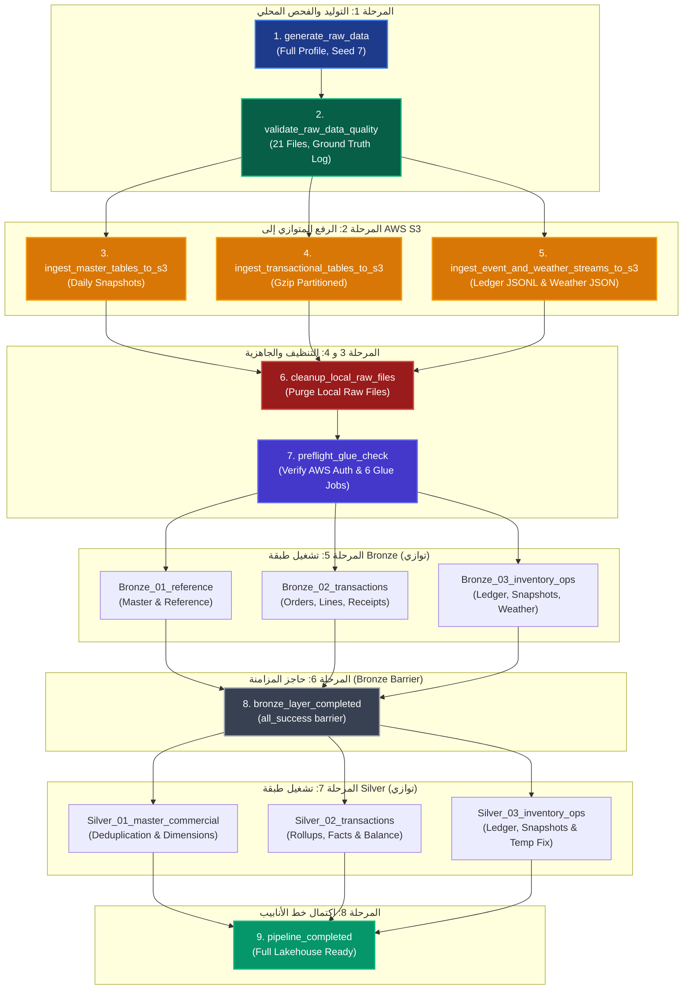

# 📚 دليل كتالوج البيانات الخام والعيوب المحقونة المحدّث

## منصة ذكاء المستودعات الذكية وسلاسل الإمداد على AWS (Smart Warehouse Intelligence Platform)

### التوثيق الهندسي الشامل — الإصدار 2.5 (Simulation Engine & Formal Defect Taxonomy Edition)

---

## 📌 الفهرس العام (Table of Contents)

1. [نظرة عامة والبيئة التشغيلية (System Overview & Architecture)](#1-نظرة-عامة-والبيئة-التشغيلية)
2. [معمارية محرك التوليد الحديثة (Generator Core & Simulation Engine)](#2-معمارية-محرك-التوليد-الحديثة)
3. [مستويات التوليد وخيارات التشغيل (Generation Profiles & CLI Options)](#3-مستويات-التوليد-وخيارات-التشغيل)
4. [مصفوفة الجداول الـ 21 واستراتيجية التخزين في S3 (Raw Partitioning Matrix)](#4-مصفوفة-الجداول-الـ-21-واستراتيجية-التخزين-في-s3)
5. [التوصيف الهندسي التفصيلي والـ Schema لكل جدول (Detailed Tables Schema & Defects)](#5-التوصيف-الهندسي-التفصيلي-والـ-schema-لكل-جدول)
   - [المجموعة الأولى: البيانات المرجعية والتقويم والطقس (Reference & Environmental)](#المجموعة-الأولى-البيانات-المرجعية-والتقويم-والطقس)
   - [المجموعة الثانية: البيانات الرئيسية للأبعاد (Master Dimensions)](#المجموعة-الثانية-البيانات-الرئيسية-للأبعاد)
   - [المجموعة الثالثة: الأسعار والعروض التجارية (Commercial & Pricing)](#المجموعة-الثالثة-الأسعار-والعروض-التجارية)
   - [المجموعة الرابعة: المبيعات ومرتجعات العملاء (Sales & Returns Simulation)](#المجموعة-الرابعة-المبيعات-ومرتجعات-العملاء)
   - [المجموعة الخامسة: المشتريات واستلام الرصيف والتشغيلات (Procurement & Batches)](#المجموعة-الخامسة-المشتريات-واستلام-الرصيف-والتشغيلات)
   - [المجموعة السادسة: سجلات المخزون واللقطات وحوادث النفاد (Inventory Ledger & Snapshots)](#المجموعة-السادسة-سجلات-المخزون-واللقطات-وحوادث-النفاد)
6. [الكتالوج الرسمي الشامل للـ 56 عيباً المحقونة (Official 56 Injected Defects Taxonomy)](#6-الكتالوج-الرسمي-الشامل-للـ-56-عيباً-المحقونة)
7. [محرك التحقق والانحدار الصارم (Regression Validator — 41 Integrity Checks)](#7-محرك-التحقق-والانحدار-الصارم-regression-validator)
8. [مسار الأتمتة الموحد في Apache Airflow (End-to-End Lakehouse DAG)](#8-مسار-الأتمتة-الموحد-في-apache-airflow-end-to-end-lakehouse-dag)
9. [معمارية معالجة العيوب المنفذة في AWS Glue ومجلدات الحجر الصحي (Glue Remediation Architecture)](#9-معمارية-معالجة-العيوب-المنفذة-في-aws-glue-ومجلدات-الحجر-الصحي)

---

## 1. نظرة عامة والبيئة التشغيلية

تمت إعادة هيكلة وتطوير محرك التوليد **`data_generator`** في **الإصدار 2.5** لينتقل من توليد الجداول المستقلة المعزولة إلى **محاكاة ديناميكية حية لسلاسل الإمداد وتجارة الجملة والتجزئة (Dynamic Discrete-Event Simulation)** تحاكي السوق المصري للسلع الاستهلاكية سريعة الدوران (FMCG).

### 🌟 المبادئ الهندسية الأساسية في الإصدار 2.5:
1. **محاكاة تشغيلية يومية منبثقة (Emergent Supply Chain Simulation)**:
   - تم استبدال السكربتات التقليدية المنفصلة بمحاكي يومي شامل في [`simulation.py`](file:///c:/Users/shahb/OneDrive/Desktop/New%20folder%20(2)/data_generator/tables/simulation.py)؛ حيث ينبع دفتر الأستاذ، ولقطات المخزون، وأوامر الشراء، وأذونات الاستلام، وحوادث النفاد مباشرة من حركة البضائع الفعلية والطلبات اليومية الحقيقية على الأرفف.
2. **صرف المخزون وفق سياسة الصلاحية الأقرب (Strict FEFO Batch Allocation)**:
   - يتم حجز وصرف البضائع وفق أولوية انتهاء الصلاحية الوارد أولاً ينتهي أولاً (`First-Expired First-Out`)، مع التتبع الصارم لرقم الدفعة `batch_id` في جميع حركات الصرف والاستلام.
3. **إدارة الطلبات المؤجلة (Backorder Lifecycle)**:
   - تتبع الطلبات المؤجلة لمدة 14 يوماً عمل؛ في حال وصول توريد جديد من المورد يتم تخصيصه فوراً للطلبات الأقدم، وإذا تجاوزت 14 يوماً يتم إلغاء المتبقي تلقائياً (`CANCEL_REMAINDER`).
4. **واقعية التوقيتات وحساب فترات النقل والشحن (Non-Frozen Shift Timestamps)**:
   - القضاء التام على التوقيتات المجمدة؛ زمن الترحيل موجب (`posted_ts >= event_ts`)، وأوقات شحن وتوصيل الطلبات متغيرة واقعياً (بفارق نقل يتراوح بين ساعتين إلى 9 ساعات لتحديث حالة الطلب إلى `DELIVERED`).
5. **سجل الحقيقة الأرضية للعيوب (Defect Ground Truth Engine)**:
   - توثيق كل عيب محقون بدقة على مستوى السطر والعمود في ملف `defect_ground_truth.json`، ومطابقته مع كتالوج رسمي مكون من 56 عيباً موثقاً في `defect_catalog.csv` (ضمن تسلسل الأكواد الممتد من `DEF-BAT-001` إلى `DEF-WTH-002` مع تجاوز الرمز `DEF-SOL-002`).
6. **أداة فحص وانحدار صارمة (Automated Regression Validator)**:
   - تضمين سكربت [`validate.py`](file:///c:/Users/shahb/OneDrive/Desktop/New%20folder%20(2)/data_generator/validate.py) الذي يختبر 41 قاعدة بيزنس وسلامة بيانات للبيانات النظيفة قبل وبعد حقن العيوب.

### 🇪🇬 الخصائص المحلية المصرية المعتمدة (Egyptian Localization Context):
- **العملة الرسمية**: الجنيه المصري (`EGP`).
- **المنطقة الزمنية**: توقيت القاهرة الرسمي (`Africa/Cairo` / `UTC+02:00`).
- **أيام العمل**: من السبت إلى الخميس (`SAT-THU`)، ويوم الجمعة عطلة تشغيلية كاملة للمستودعات وحركات الشحن.
- **التغطية الجغرافية الكاملة (27 محافظة)**: تم توسيع النطاق ليشمل جميع محافظات مصر الـ 27 (القاهرة، الجيزة، الإسكندرية، الدلتا، القناة، الصعيد، البحر الأحمر، وسيناء).
- **مصفوفة توزيع المستودعات المركزية (`GOVERNORATE_WAREHOUSE`)**:
  - مستودع القاهرة الكبرى والجيزة (`WH01` - 6 أكتوبر): يخدم القاهرة، الجيزة، القليوبية، الشرقية، المنوفية، الإسماعيلية، السويس، البحر الأحمر، وشمال/جنوب سيناء.
  - مستودع الإسكندرية والساحل (`WH02` - برج العرب): يخدم الإسكندرية، البحيرة، الغربية، الدقهلية، بورسعيد، دمياط، كفر الشيخ، ومطروح.
  - مستودع الصعيد والوجه القبلي (`WH03` - أسيوط الصناعية): يخدم الفيوم، بني سويف، المنيا، أسيوط، سوهاج، قنا، الأقصر، أسوان، والوادي الجديد.
- **أوزان التوزيع السكاني (`GOVERNORATE_WEIGHT`)**: توزيع أعداد العملاء وتردد الطلبات وفق الثقل الديمغرافي الحقيقي للمحافظات.
- **التقويم الهجري والمناسبات الدينية**: حساب فلكي دقيق للشهور الهجرية (رمضان، عيد الفطر، عيد الأضحى، رأس السنة الهجرية، المولد النبوي) وعيد القيامة القبطي وشم النسيم.
- **حدود المناخ الطبيعية**: ضبط درجات الحرارة الدنيا لتتوافق مع المناخ المصري (حد أدنى 5°C للإسكندرية، 3°C للجيزة، 2°C لأسيوط لمنع درجات الحرارة السالبة غير الواقعية).

---

## 2. معمارية محرك التوليد الحديثة

يتكون المجلد [`data_generator/`](file:///c:/Users/shahb/OneDrive/Desktop/New%20folder%20(2)/data_generator) من طبقات معمارية مفصولة ومنظمة تمنع التداخل:

```
data_generator/
├── __init__.py
├── config.py                       # تكوينات البروفايل، الـ 27 محافظة، وخريطة المستودعات
├── defects.py                      # دوال التحقق وتوليد باركود GS1 EAN-13
├── defect_catalog.csv              # الكتالوج المرجعي للـ 56 عيباً ومعدلاتها
├── generator.py                    # نقطة الدخول الرئيسية للأوركسترا والتوليد
├── validate.py                     # سكربت الفحص الصارم (41 فحص سلامة وتكامل)
├── core/                           # النواة المعزولة (مستقلة بذاتها)
│   ├── __init__.py
│   ├── rng.py                      # مولدات عشوائية حتمية معزولة لكل نطاق (RNG Hubs)
│   ├── timeutil.py                 # دوال حساب أوقات العمل والورديات وفترات التوصيل
│   └── registry.py                 # محرك حقن العيوب وتسجيل الحقيقة الأرضية (Defect Registry)
└── tables/                         # مولدات الجداول والمحاكاة
    ├── __init__.py
    ├── reference_data.py           # الفئات (R01)، التقويم (R20)، والطقس (R21)
    ├── master_data.py              # المستودعات (R03)، المنتجات (R02)، الموردين (R04)، وعقودهم (R05)، والعملاء (R06)
    ├── commercial_data.py          # كتالوج التسعير الموحد، الأسعار (R15)، التكاليف (R16)، والعروض (R17)
    ├── simulation.py               # محرك المحاكاة اليومي لسلاسل الإمداد (R07-R14, R18, R19)
    └── sim_defects.py              # محقن العيوب لجداول المحاكاة والمعاملات
```

---

## 3. مستويات التوليد وخيارات التشغيل

يدعم المولد ثلاثة مستويات حجمية محددة في `data_generator/config.py`:

| المقياس / الكيان | Profile: `test` (سريع للتطوير) | Profile: `medium` (متوسط) | Profile: `full` (إنتاجي ضخم - الافتراضي) |
| :--- | :--- | :--- | :--- |
| **المنتجات (Products)** | 60 منتج | 250 منتج | **800 منتج** |
| **الموردين (Suppliers)** | 15 مورد | 35 مورد | **40 مورد** |
| **العملاء (Customers)** | 80 عميل | 400 عميل | **2,400 عميل (عبر 27 محافظة)** |
| **أوامر البيع (Sales Orders)** | ~360 أمر | ~2,500 أمر | **~25,000 أمر** |
| **أوامر الشراء (POs)** | ~200 أمر | ~1,200 أمر | **~8,000 أمر** |
| **حركات المخازن (Txns)** | ~1,300 حركة | ~12,000 حركة | **~117,000 حركة** |
| **أيام اللقطات (Snapshots)** | 14 يوم | 60 يوم | **365 يوم (سنة كاملة)** |
| **النطاق الزمني** | شهر واحد (Jan 2024) | 6 أشهر (H1 2024) | **سنتان كاملتان (2024 – 2025)** |

### 💻 أوامر التشغيل عبر سطر الأوامر (CLI Usage):

```bash
# 1. تثبيت المتطلبات الضرورية
pip install pandas numpy hijridate

# 2. توليد البيانات الإنتاجية الكاملة مع العيوب المحقونة والبذرة الحتمية
python -m data_generator.generator --profile full --seed 7 --output-dir data/raw

# 3. توليد نسخة مرجعية نظيفة 100% بدون أي عيوب للمقارنة واختبار الـ Benchmarking
python -m data_generator.generator --profile test --seed 7 --no-defects --output-dir /tmp/clean

# 4. تشغيل سكربت التحقق التلقائي للتأكد من سلامة البيانات النظيفة (41 فحصاً)
python -m data_generator.validate /tmp/clean
```

### 📦 مخرجات مجلد التوليد (`--output-dir`):
عند اكتمال التوليد، يحتوي المجلد على:
1. **الـ 21 ملفاً خاماً** (بصيغ CSV و JSON و JSONL).
2. **`generation_manifest.json`**: تقرير تلخيصي بزمن التوليد، اسم البروفايل، البذرة العشوائية، وعدد السجلات في كل جدول.
3. **`defect_ground_truth.json`**: سجل تدقيق كامل بكل عيب تم حقنه، والجدول المتأثر، والعمود، وقيمة المفتاح، ووصف العيب، والإجراء المتوقع (`reject` أو `flag` أو `fix`).

---

## 4. مصفوفة الجداول الـ 21 واستراتيجية التخزين في S3

| الكود | اسم الجدول | الصيغة المحلية | مسار التقسيم في AWS S3 (Raw Partitioning Scheme) | نمط التخزين والتحديث |
| :--- | :--- | :--- | :--- | :--- |
| **R01** | `product_categories` | `.csv` | `raw/product_categories/snapshot_date=YYYY-MM-DD/product_categories.csv` | Daily Full Snapshot |
| **R02** | `products` | `.csv` | `raw/products/snapshot_date=YYYY-MM-DD/products.csv` | Daily Full Snapshot |
| **R03** | `warehouses` | `.csv` | `raw/warehouses/snapshot_date=YYYY-MM-DD/warehouses.csv` | Clean Control Snapshot |
| **R04** | `suppliers` | `.csv` | `raw/suppliers/snapshot_date=YYYY-MM-DD/suppliers.csv` | Daily Full Snapshot |
| **R05** | `supplier_products` | `.csv` | `raw/supplier_products/snapshot_date=YYYY-MM-DD/supplier_products.csv` | Contract Link Snapshot |
| **R06** | `customers` | `.csv` | `raw/customers/snapshot_date=YYYY-MM-DD/customers.csv` | Daily Full Snapshot |
| **R07** | `sales_orders` | `.csv.gz` | `raw/sales_orders/year=YYYY/month=MM/day=DD/sales_orders_YYYYMMDD.csv.gz` | Partitioned Incremental |
| **R08** | `sales_order_lines` | `.csv.gz` | `raw/sales_order_lines/year=YYYY/month=MM/day=DD/sales_order_lines_YYYYMMDD.csv.gz` | Partitioned Incremental |
| **R09** | `sales_returns` | `.csv.gz` | `raw/sales_returns/year=YYYY/month=MM/day=DD/sales_returns_YYYYMMDD.csv.gz` | Partitioned Incremental |
| **R10** | `purchase_orders` | `.csv.gz` | `raw/purchase_orders/year=YYYY/month=MM/day=DD/purchase_orders_YYYYMMDD.csv.gz` | Partitioned Incremental |
| **R11** | `purchase_order_lines`| `.csv.gz` | `raw/purchase_order_lines/year=YYYY/month=MM/day=DD/purchase_order_lines_YYYYMMDD.csv.gz`| Partitioned Incremental |
| **R12** | `goods_receipt_lines` | `.csv.gz` | `raw/goods_receipt_lines/year=YYYY/month=MM/day=DD/goods_receipt_lines_YYYYMMDD.csv.gz` | Partitioned Incremental |
| **R13** | `inventory_transactions`| `.jsonl.gz`| `raw/inventory_transactions/year=YYYY/month=MM/day=DD/inventory_transactions_YYYYMMDD.jsonl.gz`| Append Event Stream |
| **R14** | `inventory_snapshots` | `.csv.gz` | `raw/inventory_snapshots/year=YYYY/month=MM/day=DD/inventory_snapshots_YYYYMMDD.csv.gz` | Periodic Partitioned |
| **R15** | `product_prices` | `.csv` | `raw/product_prices/snapshot_date=YYYY-MM-DD/product_prices.csv` | Commercial Catalog |
| **R16** | `product_costs` | `.csv` | `raw/product_costs/snapshot_date=YYYY-MM-DD/product_costs.csv` | Commercial Catalog |
| **R17** | `promotions` | `.csv` | `raw/promotions/snapshot_date=YYYY-MM-DD/promotions.csv` | Commercial Reference |
| **R18** | `stockout_events` | `.csv.gz` | `raw/stockout_events/year=YYYY/month=MM/day=DD/stockout_events_YYYYMMDD.csv.gz` | Operational Incident |
| **R19** | `product_batches` | `.csv.gz` | `raw/product_batches/year=YYYY/month=MM/day=DD/product_batches_YYYYMMDD.csv.gz` | Lot Traceability |
| **R20** | `calendar_events` | `.csv` | `raw/calendar_events/snapshot_date=YYYY-MM-DD/calendar_events.csv` | Reference Dimension |
| **R21** | `weather_daily` | `.json` | `raw/weather_daily/year=YYYY/month=MM/weather_daily_YYYYMMDD.json` | Monthly Partitioned |

---

## 5. التوصيف الهندسي التفصيلي والـ Schema لكل جدول

### المجموعة الأولى: البيانات المرجعية والتقويم والطقس (Reference & Environmental)

#### 📦 R01: `product_categories.csv`
- **الوصف**: شجرة التصنيفات الهرمية للسلع (8 فئات رئيسية L1 و40 فئة فرعية L2).
- **الـ Schema**:
  - `category_id` (PK): كود الفئة (`CAT-01`, `CAT-0101`).
  - `parent_category_id` (FK): كود الفئة الأب (NULL للفئات الرئيسية L1).
  - `category_name`: اسم الفئة.
  - `category_level`: المستوى الهرمي (1 أو 2).
  - `default_storage_type`: درجة الحفظ الافتراضية (`AMBIENT`, `CHILLED`, `FROZEN`).
  - `is_perishable_default`: قابلية التلف الافتراضية.
  - `updated_ts`: توقيت التحديث.
- **العيوب المحقونة المعتمدة**:
  * `DEF-CAT-001` (Rate: 25% | Action: `fix`): مسافات زائدة وتخبط أحرف في `category_name`.
  * `DEF-CAT-002` (Rate: 0.5% | Action: `fix`): فئة يتيمة يتم تعيين `parent_category_id = 'CAT-99'` غير الموجود.
  > **تنبيه المعالجة في Glue**: يجب على خط أنابيب Silver استنتاج كود الأب من أول 6 أحرف لكود الفئة (`CAT-0105` ⬅️ `CAT-01`) بدلاً من تصفيره، للحفاظ على `l1_category_id`.

#### 📦 R20: `calendar_events.csv`
- **الوصف**: التقويم الرسمي للأعياد والمواسم الدينية والتجارية المصرية لسنوات المحاكاة بالإضافة لسنة مستقبلية للتنبؤ.
- **الـ Schema**:
  - `event_id` (PK): كود الحدث (`EVT-2024-01`).
  - `event_name`: اسم المناسبة.
  - `event_type`: نوع الحدث (`PUBLIC_HOLIDAY`, `RELIGIOUS_SEASON`, `SCHOOL_SEASON`, `RETAIL_EVENT`).
  - `start_date`, `end_date`: تواريخ البداية والنهاية.
  - `closes_warehouse`: هل يغلق المستودع أبوابه أثناء العطلة؟
  - `expected_demand_effect`: أثر الطلب المتوقع (`UP`, `DOWN`, `MIXED`).
  - `source_note`: مصدر التوثيق (`OFFICIAL_CALENDAR`, `ASSUMPTION`).
  - `updated_ts`: توقيت التحديث.
- **العيوب المحقونة المعتمدة**:
  * `DEF-CAL-001` (Rate: 4% | Action: `fix`): تباين في مسميات عيد الفطر بسبب استطلاع الهلال (`EID AL FITR HOLIDAY - Moon Sighting TBD`).

#### 📦 R21: `weather_daily.json`
- **الوصف**: الرصد الجوي اليومي للمناطق المحيطة بالمستودعات الثلاثة (Giza, Alexandria, Assiut).
- **الـ Schema**:
  - `obs_date`, `location_code` (Composite PK): تاريخ الرصد والمنطقة.
  - `temp_max_c`, `temp_min_c`: درجات الحرارة العظمى والصغرى المئوية (مع تطبيق حد أدنى فيزيائي: 5°C للإسكندرية، 3°C للجيزة، 2°C لأسيوط).
  - `precip_mm`: معدل هطول الأمطار.
  - `source`: مصدر القراءة (`SYNTHETIC_MODEL`).
- **العيوب المحقونة المعتمدة**:
  * `DEF-WTH-001` (Rate: 0.5% | Action: `fix`): تسجيل درجات الحرارة بالفهرنهايت (`temp * 1.8 + 32`).
  * `DEF-WTH-002` (Rate: 1% | Action: `flag`): أيام رصد مفقودة لاختبار ملء الفجوات.

---

### المجموعة الثانية: البيانات الرئيسية للأبعاد (Master Dimensions)

#### 📦 R02: `products.csv`
- **الوصف**: كتالوج الأصناف المتاح للتداول.
- **الـ Schema**:
  - `product_id` (PK): كود الصنف (`P000001`).
  - `sku_code` (Unique): كود التخزين (`SKU-000001`).
  - `product_name`, `brand`: اسم المنتج والعلامة التجارية.
  - `category_id` (FK): كود الفئة الفرعية L2.
  - `base_uom`, `units_per_case`, `case_weight_kg`: وحدات ومقاييس التعبئة.
  - `storage_type`: نوع التخزين (`AMBIENT`, `CHILLED`, `FROZEN`).
  - `is_perishable`: قابلية التلف السريع.
  - `shelf_life_days`: مدة الصلاحية بالأيام (محسوبة لجميع السلع وفق طبيعتها).
  - `status`: حالة الصنف (`ACTIVE`, `DISCONTINUED`).
  - `launch_date`, `discontinued_date`: تواريخ دورة حياة الصنف.
  - `barcode_ean13`: باركود GS1 القياسي ببادئة مصر `622`.
  - `updated_ts`: توقيت التحديث.
- **العيوب المحقونة المعتمدة**:
  * `DEF-PRD-001` (Rate: 1% | Action: `reject`): تكرار كود `sku_code` لصنفين مختلفين (يتطلب العزل في الكوارنتين).
  * `DEF-PRD-002` (Rate: 2% | Action: `flag`): سلع طازجة بصلاحية مفقودة (`shelf_life_days is NULL`).
  * `DEF-PRD-003` (Rate: 15% | Action: `fix`): مسافات وتخبط أحرف في `brand`.
  * `DEF-PRD-004` (Rate: 1% | Action: `flag`): باركود تالف يفشل في اختبار Modulo-10 Checksum.

#### 📦 R03: `warehouses.csv`
- **الوصف**: المستودعات المركزية الثلاثة (Control Dimension نظيف بدون عيوب).
- **الـ Schema**:
  - `warehouse_id` (PK): `WH01` (Giza), `WH02` (Alexandria), `WH03` (Assiut).
  - `warehouse_name`, `governorate`, `city`, `timezone`.
  - `capacity_pallet_positions`: السعات (18,000 / 12,000 / 8,500 باليت).
  - `has_chilled_zone`: غرف التبريد (`True` لجميع المستودعات).
  - `operating_days`: أيام العمل (`SAT-THU`).
  - `order_cutoff_local`: مواعيد إغلاق استقبال الطلبات (`17:00`, `16:00`, `15:00`).
  - `opened_date`, `status`, `updated_ts`.

#### 📦 R04: `suppliers.csv`
- **الوصف**: شبكة الموردين والمصانع المعتمدة.
- **الـ Schema**:
  - `supplier_id` (PK): كود المورد (`SUP001`).
  - `supplier_name`, `supplier_type` (`MANUFACTURER`, `DISTRIBUTOR`, `IMPORTER`).
  - `governorate`: محافظة المورد.
  - `payment_terms_days`: شروط الدفع التعاقدية (15، 30، 60، 90 يوماً).
  - `is_imported`, `status`, `onboarded_date`, `updated_ts`.
- **العيوب المحقونة المعتمدة**:
  * `DEF-SUP-001` (Rate: 20% | Action: `fix`): مسافات زائدة وتخبط أحرف في اسم المورد.
  * `DEF-SUP-002` (Rate: 1% | Action: `flag`): محافظة مفقودة (`governorate is NULL`).

#### 📦 R05: `supplier_products.csv`
- **الوصف**: اتفاقيات التوريد والأسعار والـ MOQs المتناسبة مع مدة صلاحية السلع.
- **الـ Schema**:
  - `supplier_id`, `product_id` (Composite PK): كود المورد والسلعة.
  - `supplier_sku`: كود الصنف لدى المورد.
  - `units_per_case`, `moq_cases`, `order_multiple_cases`: قيود الشراء.
  - `contractual_lead_time_days`: مهلة التوريد (1-3 أيام للطازج، وحتى 21 يوماً للسلع المعمرة).
  - `cost_per_case_egp`: تكلفة الكرتونة مشتقة من كتالوج التكلفة الأساسي.
  - `is_primary`: هل هو المورد الأساسي؟
  - `effective_from`, `effective_to`, `updated_ts`.
- **العيوب المحقونة المعتمدة**:
  * `DEF-SPR-001` (Rate: 4% | Action: `flag`): مهلة توريد تعاقدية مفقودة (`contractual_lead_time_days is NULL`).
  * `DEF-SPR-002` (Rate: 0.5% | Action: `flag`): فترات تعاقد متداخلة لنفس المورد والصنف بتكلفة مختلفة.
  * `DEF-SPR-003` (Rate: 0.3% | Action: `flag`): تعيين موردين رئيسيين لنفس الصنف (`is_primary = True`).

#### 📦 R06: `customers.csv`
- **الوصف**: عملاء الجملة والتجزئة عبر كافة محافظات مصر الـ 27.
- **الـ Schema**:
  - `customer_id` (PK): كود العميل (`C000001`).
  - `customer_name`, `segment` (`SUPERMARKET`, `HYPERMARKET`, `MINI_MARKET`, `WHOLESALER`, `HORECA`).
  - `governorate`: المحافظة (موزعة على كافة المحافظات الـ 27).
  - `city`: المدينة أو المركز.
  - `assigned_warehouse_id` (FK): المستودع المخصص جغرافياً وفق خريطة `GOVERNORATE_WAREHOUSE`.
  - `credit_terms_days`, `status`, `created_date`, `updated_ts`.
- **العيوب المحقونة المعتمدة**:
  * `DEF-CUS-001` (Rate: 75% | Action: `fix`): تنوع غير قياسي في تسمية الفئات (مثل `mini_market`, `Mini Market`).
  * `DEF-CUS-002` (Rate: 1% | Action: `fix`): أخطاء إملائية في اسم المحافظة (`Moonufiaa` بدلاً من `Monufia`).

---

### المجموعة الثالثة: الأسعار والعروض التجارية (Commercial & Pricing)

#### 📦 R15: `product_prices.csv`
- **الوصف**: قوائم أسعار البيع للعملاء بالجنيه المصري مشتقة من كتالوج التسعير الموحد.
- **الـ Schema**:
  - `product_id`, `price_list`, `effective_from` (Composite PK).
  - `list_price_egp`: سعر بيع القطعة الفردية (EA).
  - `effective_to`, `updated_ts`.
- **العيوب المحقونة المعتمدة**:
  * `DEF-PRC-001` (Rate: 0.1% | Action: `reject`): سعر بيع يساوي صفراً.
  * `DEF-PRC-002` (Rate: 0.1% | Action: `reject`): تواريخ معكوسة (`effective_to < effective_from`).
  * `DEF-PRC-003` (Rate: 0.5% | Action: `flag`): فترات سعرية متداخلة متضاربة في السعر.

#### 📦 R16: `product_costs.csv`
- **الوصف**: تكلفة الإنزال المعيارية (Landed Cost) متوافقة تماماً مع أسعار البيع ونسب التضخم القطاعية (`CAT_INFLATION`).
- **الـ Schema**:
  - `product_id`, `cost_type`, `effective_from` (Composite PK).
  - `cost_per_base_unit_egp`: تكلفة القطعة الفردية بالجنيه المصري.
  - `effective_to`, `updated_ts`.
- **العيوب المحقونة المعتمدة**:
  * `DEF-CST-001` (Rate: 0.4% | Action: `flag`): شذوذ في التكلفة حيث تفوق سعر البيع (`margin_anomaly`).
  * `DEF-CST-002` (Rate: 1% | Action: `flag`): فجوة زمنية بين فترات التكلفة المتتالية.

#### 📦 R17: `promotions.csv`
- **الوصف**: العروض الترويجية والحملات التسويقية.
- **الـ Schema**:
  - `promo_id` (PK): كود العرض (`PRM-2024-01`).
  - `product_id`, `warehouse_id` (FK): نطاق الصنف والمستودع.
  - `promo_name`, `promo_type`, `discount_pct`.
  - `start_date`, `end_date`.
  - `funded_by` (`SUPPLIER`, `SELF`, `SHARED`), `supplier_funding_pct`.
  - `updated_ts`.
- **العيوب المحقونة المعتمدة**:
  * `DEF-PRM-001` (Rate: 0.3% | Action: `reject`): تاريخ نهاية العرض يسبق تاريخ بدايته.
  * `DEF-PRM-002` (Rate: 3% | Action: `flag`): عروض متداخلة لنفس الصنف بنسب خصم مختلفة.

---

### المجموعة الرابعة: المبيعات ومرتجعات العملاء (Sales & Returns Simulation)

#### 📦 R07: `sales_orders.csv.gz`
- **الوصف**: ترويسة أوامر البيع الناتجة عن محاكاة طلبات العملاء اليومية وتوجيهها للمستودعات.
- **الـ Schema**:
  - `sales_order_id` (PK): كود أمر البيع (`SO0000000001`).
  - `customer_id`, `warehouse_id`: كود العميل والمستودع المنفذ.
  - `order_ts`, `requested_delivery_date`.
  - `channel` (`PHONE`, `PORTAL`, `SALES_REP`).
  - `order_status` (`DELIVERED`, `SHIPPED`, `SHORT_SHIPPED`, `CANCELLED`).
  - `cancelled_ts`, `cancel_reason`, `currency_code` (`EGP`).
  - `total_net_amount_egp`: إجمالي القيمة الصافية.
  - `source_updated_ts`: وقت التحديث الفعلي (يتغير عند الشحن والتسليم لمنع تجميد التوقيت).
- **العيوب المحقونة المعتمدة**:
  * `DEF-SO-001` (Rate: 0.4% | Action: `fix`): تكرار ترويسة الطلب بالكامل.
  * `DEF-SO-002` (Rate: 3% | Action: `fix`): إرسال نسخة قديمة من الطلب (يتطلب اختيار الأحدث زمناً).
  * `DEF-SO-003` (Rate: 0.3% | Action: `flag`): عدم تطابق إجمالي الرأس مع مجموع أسطره المالية.

#### 📦 R08: `sales_order_lines.csv.gz`
- **الوصف**: سطور بنود المبيعات وتخصيص المخزون وإدارة الـ Backorders.
- **الـ Schema**:
  - `sales_order_id`, `line_no` (Composite PK).
  - `product_id`, `warehouse_id`.
  - `qty_ordered`, `qty_allocated`, `qty_shipped`: الكميات المطلوبة والمحجوزة والمشحونة.
  - `uom` (`EA`).
  - `list_price_egp`, `discount_pct`, `unit_net_price_egp`, `promo_id`.
  - `line_status` (`SHIPPED`, `SHORT_SHIPPED`, `CANCELLED`).
  - `shortage_action` (`NONE`, `BACKORDER`, `CANCEL_REMAINDER`).
  - `shipped_ts`, `source_updated_ts`.
- **العيوب المحقونة المعتمدة**:
  * `DEF-SOL-001` (Rate: 0.3% | Action: `fix`): تكرار سطر الطلب.
  * `DEF-SOL-003` (Rate: 0.05% | Action: `flag`): كمية مشحونة تفوق الكمية المطلوبة (`qty_shipped > qty_ordered`).
  * `DEF-SOL-004` (Rate: 0.02% | Action: `reject`): كمية مطلوبة سالبة مستحيلة (`qty_ordered < 0`).
  * `DEF-SOL-005` (Rate: 0.5% | Action: `flag`): سعر صافي غير متطابق رياضياً مع السعر والخصم.
  * `DEF-SOL-006` (Rate: 1% | Action: `flag`): وجود خصم بدون كود العرض `promo_id`.
  * `DEF-SOL-007` (Rate: 0.5% | Action: `flag`): سطر مسجل كـ `SHIPPED` رغم أن الكمية المشحونة أقل من المطلوبة.

#### 📦 R09: `sales_returns.csv.gz`
- **الوصف**: مرتجعات العملاء من البضائع المسلمة فعلياً وتحديد مصيرها (إعادة تخزين أو إتلاف أو رد للمورد).
- **الـ Schema**:
  - `return_line_id` (PK): كود المرتجع (`RL000000001`).
  - `sales_order_id`, `line_no`, `product_id`, `warehouse_id`.
  - `return_ts`: توقيت تسجيل المرتجع.
  - `qty_returned`: الكمية المرتجعة.
  - `return_reason` (`EXPIRED`, `DAMAGED`, `CUSTOMER_REMORSE`, `WRONG_ITEM`).
  - `disposition` (`RESTOCK`, `WRITE_OFF`, `SUPPLIER_RETURN`).
  - `refund_amount_egp`, `updated_ts`.
- **العيوب المحقونة المعتمدة**:
  * `DEF-RET-001` (Rate: 0.1% | Action: `reject`): تاريخ المرتجع يسبق تاريخ شحن الطلب.
  * `DEF-RET-002` (Rate: 0.2% | Action: `flag`): كمية مرتجعة تفوق الكمية المشحونة للعميل.
  * `DEF-RET-003` (Rate: 0.3% | Action: `reject`): مرتجع يشير إلى أمر بيع وهمي غير موجود.
  * `DEF-RET-004` (Rate: 5% | Action: `fix`): بضاعة تالفة أو منتهية الصلاحية مسجلة كـ `RESTOCK` (يتطلب تصحيحها لمنع إعادة بيع الفاسد).

---

### المجموعة الخامسة: المشتريات واستلام الرصيف والتشغيلات (Procurement & Batches)

#### 📦 R10: `purchase_orders.csv.gz`
- **الوصف**: أوامر الشراء المنبثقة آلياً لتعويض المخزون وإعادة التوازن.
- **الـ Schema**:
  - `purchase_order_id` (PK): كود أمر الشراء (`PO0000001`).
  - `supplier_id`, `warehouse_id`, `po_created_ts`, `requested_delivery_date`.
  - `po_status` (`OPEN`, `PARTIALLY_RECEIVED`, `CLOSED`, `CANCELLED`).
  - `payment_terms_days`, `total_amount_egp`, `created_by` (`AUTO_REPLEN`, `BUYER`).
  - `source_updated_ts`.
- **العيوب المحقونة المعتمدة**:
  * `DEF-PO-001` (Rate: 0.5% | Action: `fix`): تكرار أمر الشراء.
  * `DEF-PO-002` (Rate: 1% | Action: `fix`): تأخر تحديث الحالة (يظل `OPEN` رغم استلام البضاعة).
  * `DEF-PO-003` (Rate: 0.1% | Action: `flag`): أمر شراء ملغي وله استلامات فعلية على الرصيف.

#### 📦 R11: `purchase_order_lines.csv.gz`
- **الوصف**: بنود أوامر الشراء بالكرتونة (`CASE`).
- **الـ Schema**:
  - `purchase_order_id`, `po_line_no` (Composite PK).
  - `product_id`, `order_uom` (`CASE`), `qty_ordered_uom`, `units_per_case`.
  - `unit_cost_per_uom_egp`, `promised_delivery_date`, `line_status`, `source_updated_ts`.
- **العيوب المحقونة المعتمدة**:
  * `DEF-POL-001` (Rate: 6% | Action: `flag`): تاريخ التسليم الموعود فارغ (`promised_delivery_date is NULL`).
  * `DEF-POL-002` (Rate: 0.3% | Action: `flag`): كمية مطلوبة تقل عن الحد الأدنى المتفق عليه (Below MOQ).

#### 📦 R12: `goods_receipt_lines.csv.gz`
- **الوصف**: حركة استلام البضائع على الرصيف والفحص وتسجيل التشغيلات وتواريخ الصلاحية.
- **الـ Schema**:
  - `receipt_id`, `receipt_line_no` (Composite PK).
  - `purchase_order_id`, `po_line_no`, `product_id`, `warehouse_id`.
  - `received_ts`, `supplier_delivery_note`.
  - `qty_received_uom`, `qty_rejected_uom`, `order_uom` (`CASE`).
  - `batch_number`, `expiry_date`, `updated_ts`.
- **العيوب المحقونة المعتمدة**:
  * `DEF-GR-001` (Rate: 0.3% | Action: `flag`): استلام أعمى بدون أمر شراء (`blind_receipt`).
  * `DEF-GR-002` (Rate: 2% | Action: `flag`): استلام كميات زائدة عن المطلوب في أمر الشراء (Over-delivery).
  * `DEF-GR-003` (Rate: 0.1% | Action: `reject`): تاريخ الصلاحية يسبق تاريخ وصول الشحنة على الرصيف.

#### 📦 R19: `product_batches.csv.gz`
- **الوصف**: سجل تشغيلات ودفعات الإنتاج وتتبع الصلاحية بالمستودع.
- **الـ Schema**:
  - `batch_id` (PK): كود الدفعة (`B000001`).
  - `warehouse_id`, `product_id`, `receipt_id`, `receipt_line_no`.
  - `batch_number`, `production_date`, `expiry_date`.
  - `qty_received_base`, `status` (`ACTIVE`, `EXPIRED`, `DEPLETED`), `updated_ts`.
- **العيوب المحقونة المعتمدة**:
  * `DEF-BAT-001` (Rate: 0.1% | Action: `reject`): تاريخ الصلاحية يسبق تاريخ الإنتاج (`expiry < production`).
  * `DEF-BAT-002` (Rate: 0.5% | Action: `flag`): تكرار نفس رقم التشغيلة عبر موردين أو منتجات مختلفة.

---

### المجموعة السادسة: سجلات المخزون واللقطات وحوادث النفاد (Inventory Ledger & Snapshots)

#### 📦 R13: `inventory_transactions.jsonl.gz`
- **الوصف**: دفتر أستاذ حركات المخزون المتدفقة في الوقت الفعلي (WMS Double-Entry Event Ledger).
- **الـ Schema**:
  - `txn_id` (PK): كود الحركة الفريد (`TX000000001`).
  - `event_ts`: وقت وقوع الحركة الفعلي.
  - `posted_ts`: وقت ترحيل الحركة على السيستم (`posted_ts >= event_ts`).
  - `warehouse_id`, `product_id`.
  - `txn_type` (`RECEIPT`, `ISSUE`, `RETURN_RESTOCK`, `ADJUSTMENT`, `WRITE_OFF_EXPIRY`).
  - `qty_change_base`: كمية التغير بالقطع (سالب للصرف، موجب للإضافة).
  - `reference_type` (`SO_LINE`, `GR_LINE`, `RET_LINE`, `EXPIRY_SCAN`, `INITIAL_LOAD`).
  - `reference_id`: كود المستند المرجعي.
  - `batch_id` (FK): كود الدفعة المنصرفة أو المستلمة.
  - `reason_code`, `event_seq`, `source_system` (`WMS`).
- **العيوب المحقونة المعتمدة**:
  * `DEF-INV-001` (Rate: 0.1% | Action: `flag`): خطأ في إشارة الكمية (صرف بإشارة موجبة أو استلام بسالب).
  * `DEF-INV-002` (Rate: 0.1% | Action: `flag`): مرجع المستند مفقود (`reference_id is NULL`).
  * `DEF-INV-003` (Rate: 0.1% | Action: `flag`): حركة تسوية بدون كود سبب (`reason_code is NULL`).
  * `DEF-INV-004` (Rate: 0.1% | Action: `flag`): توقيت الترحيل يسبق توقيت وقوع الحركة (Clock Skew).
  * `DEF-INV-005` (Rate: 0.3% | Action: `fix`): تكرار حركة المخزن بالكامل.

#### 📦 R14: `inventory_snapshots.csv.gz`
- **الوصف**: اللقطات اليومية التراكمية في نهاية كل يوم عمل مطابقة محاسبياً لحركات دفتر الأستاذ.
- **الـ Schema**:
  - `snapshot_date`, `warehouse_id`, `product_id` (Composite PK).
  - `on_hand_qty`: الرصيد الفعلي على الأرفف.
  - `allocated_qty`: الكميات المحجوزة للطلبات تحت التجهيز.
  - `blocked_qty`: الكميات المجمدة أو المعزولة.
  - `snapshot_ts`: وقت أخذ اللقطة (`23:59:00+02:00`).
  - `source_batch_id`: معرف تشغيلة الإغلاق الليلي.
- **العيوب المحقونة المعتمدة**:
  * `DEF-SNP-001` (Rate: 0.05% | Action: `flag`): رصيد فعلي سالب مستحيل (`on_hand_qty < 0`).
  * `DEF-SNP-002` (Rate: 0.5% | Action: `flag`): لقطة ميتة منسوخة من اليوم السابق دون تحديث.
  * `DEF-SNP-003` (Rate: 1% | Action: `flag`): لقطات يوم كامل مفقودة لجميع السلع.

#### 📦 R18: `stockout_events.csv.gz`
- **الوصف**: حوادث نفاد المخزون المرصودة عند اصطدام طلبات العملاء بالعجز أو انخفاض الرصيد إلى صفر.
- **الـ Schema**:
  - `stockout_id` (PK): كود العجز (`STK0000001`).
  - `warehouse_id`, `product_id`.
  - `start_ts`: توقيت بداية العجز.
  - `end_ts`: توقيت زوال العجز بوصول توريد أو استرجاع جديد (تُغلق ديناميكياً في المحاكي).
  - `detection_source` (`WMS_ATP_ZERO`).
  - `trigger_ref`: كود أمر البيع والسطر الذي أطلق العجز (`SOxxxx:LineN`).
  - `updated_ts`.
- **العيوب المحقونة المعتمدة**:
  * `DEF-STK-001` (Rate: 2% | Action: `flag`): حادثة نفاد مفتوحة لم تُغلق أبداً (`end_ts is NULL`).
  * `DEF-STK-002` (Rate: 3% | Action: `fix`): حادثتي نفاد متداخلتين ومكررتين لنفس السلعة والمستودع.

---

## 6. الكتالوج الرسمي الشامل للـ 56 عيباً المحقونة

المصفوفة التالية تمثل الحقيقة المرجعية الرسمية لجميع العيوب الـ 56 المعرفة في [`data_generator/defect_catalog.csv`](file:///c:/Users/shahb/OneDrive/Desktop/New%20folder%20(2)/data_generator/defect_catalog.csv) (ملاحظة: التسلسل الأبجدي للأكواد يتخطى رمز `DEF-SOL-002` ليكون إجمالي العيوب الموثقة والمحقونة 56 عيباً فعلياً):

| كود العيب (Defect ID) | الجدول (Table) | العمود المتأثر | وصف العيب الهندسي والبيزنسي | نسبة الحقن | الإجراء المتوقع في Glue | الصفوف المحقونة (Full Profile) |
| :--- | :--- | :--- | :--- | :--- | :--- | :--- |
| **DEF-BAT-001** | `product_batches` | `expiry_date` | انتهاء الصلاحية يسبق تاريخ الإنتاج | 0.001 | `reject` | 27 |
| **DEF-BAT-002** | `product_batches` | `batch_number` | تكرار رقم التشغيلة عبر منتجات وموردين مختلفين | 0.005 | `flag` | 133 |
| **DEF-CAL-001** | `calendar_events` | `event_name` | تباين في مسمى عيد الفطر لعدم ثبوت الرؤية | 0.04 | `fix` | 2 |
| **DEF-CAT-001** | `product_categories` | `category_name` | مسافات بيضاء وتخبط حروف في اسم الفئة | 0.25 | `fix` | 12 |
| **DEF-CAT-002** | `product_categories` | `parent_category_id` | فئة L2 يتيمة تشير لـ CAT-99 غير الموجود | 0.005 | `fix` | 1 |
| **DEF-CST-001** | `product_costs` | `cost_per_base_unit_egp`| تكلفة تفوق سعر البيع (شذوذ هامش الربح) | 0.004 | `flag` | 6 |
| **DEF-CST-002** | `product_costs` | `effective_to` | فجوة زمنية بين فترات التكلفة المتتالية | 0.01 | `flag` | 16 |
| **DEF-CUS-001** | `customers` | `segment` | تسميات غير قياسية لفئة العميل | 0.75 | `fix` | 1,800 |
| **DEF-CUS-002** | `customers` | `governorate` | خطأ إملائي في اسم المحافظة (`Moonufiaa`) | 0.01 | `fix` | 24 |
| **DEF-GR-001** | `goods_receipt_lines`| `purchase_order_id` | استلام أعمى بدون أمر شراء مرتبط | 0.003 | `flag` | 76 |
| **DEF-GR-002** | `goods_receipt_lines`| `qty_received_uom` | استلام كميات تفوق الكمية المطلوبة بالكرتونة | 0.02 | `flag` | 504 |
| **DEF-GR-003** | `goods_receipt_lines`| `expiry_date` | وصول شحنة برصيف الاستلام منتهية الصلاحية | 0.001 | `reject` | 25 |
| **DEF-INV-001** | `inventory_transactions`| `qty_change_base` | خطأ في إشارة الكمية (صرف موجب أو استلام سالب) | 0.001 | `flag` | 117 |
| **DEF-INV-002** | `inventory_transactions`| `reference_id` | حركة مخزنية بدون رقم مستند مرجعي | 0.001 | `flag` | 117 |
| **DEF-INV-003** | `inventory_transactions`| `reason_code` | حركة تسوية بدون كود السبب المبرر | 0.001 | `flag` | 117 |
| **DEF-INV-004** | `inventory_transactions`| `posted_ts` | توقيت الترحيل يسبق توقيت وقوع الحركة | 0.001 | `flag` | 117 |
| **DEF-INV-005** | `inventory_transactions`| - | تكرار حركة دفتر الأستاذ بالكامل | 0.003 | `fix` | 350 |
| **DEF-PO-001** | `purchase_orders` | - | تكرار ترويسة أمر الشراء | 0.005 | `fix` | 94 |
| **DEF-PO-002** | `purchase_orders` | `po_status` | حالة أمر الشراء تظل OPEN رغم استلام البضاعة | 0.01 | `fix` | 189 |
| **DEF-PO-003** | `purchase_orders` | `po_status` | أمر شراء ملغي رغم وجود استلامات على الرصيف | 0.001 | `flag` | 19 |
| **DEF-POL-001** | `purchase_order_lines`| `promised_delivery_date`| تاريخ التسليم الموعود فارغ | 0.06 | `flag` | 1,445 |
| **DEF-POL-002** | `purchase_order_lines`| `qty_ordered_uom` | كمية مطلوبة بالكرتونة تقل عن حد التوريد الأدنى | 0.003 | `flag` | 72 |
| **DEF-PRC-001** | `product_prices` | `list_price_egp` | سعر بيع الصنف مسجل بـ 0.00 | 0.001 | `reject` | 2 |
| **DEF-PRC-002** | `product_prices` | `effective_to` | تاريخ انتهاء السعر يسبق تاريخ بدايته | 0.001 | `reject` | 2 |
| **DEF-PRC-003** | `product_prices` | - | فترات سعرية متداخلة متنازعة لنفس الصنف | 0.005 | `flag` | 8 |
| **DEF-PRD-001** | `products` | `sku_code` | تكرار كود الـ SKU لصنفين مختلفين تماماً | 0.01 | `reject` | 8 |
| **DEF-PRD-002** | `products` | `shelf_life_days` | صنف طازج سريع التلف بصلاحية فارغة | 0.02 | `flag` | 16 |
| **DEF-PRD-003** | `products` | `brand` | مسافات زائدة وتخبط أحرف في الماركة | 0.15 | `fix` | 120 |
| **DEF-PRD-004** | `products` | `barcode_ean13` | باركود دولي فاشل في فحص Checksum الرقمي | 0.01 | `flag` | 8 |
| **DEF-PRM-001** | `promotions` | `end_date` | انتهاء العرض يسبق تاريخ بدايته | 0.003 | `reject` | 1 |
| **DEF-PRM-002** | `promotions` | - | عروض ترويجية متداخلة على نفس الصنف بنسب متضاربة | 0.03 | `flag` | 6 |
| **DEF-RET-001** | `sales_returns` | `return_ts` | تاريخ إرجاع البضاعة يسبق تاريخ شحنها | 0.001 | `reject` | 2 |
| **DEF-RET-002** | `sales_returns` | `qty_returned` | الكمية المرتجعة تفوق الكمية المشحونة للعميل | 0.002 | `flag` | 4 |
| **DEF-RET-003** | `sales_returns` | `sales_order_id` | مرتجع يشير لأمر بيع وهمي غير موجود | 0.003 | `reject` | 5 |
| **DEF-RET-004** | `sales_returns` | `disposition` | بضاعة تالفة أو منتهية مسجلة كـ RESTOCK | 0.05 | `fix` | 92 |
| **DEF-SNP-001** | `inventory_snapshots`| `on_hand_qty` | رصيد فعلي سالب في لقطة الإغلاق اليومي | 0.0005 | `flag` | 241 |
| **DEF-SNP-002** | `inventory_snapshots`| `on_hand_qty` | لقطة يومية ميتة منسوخة كلياً من اليوم السابق | 0.005 | `flag` | 2,409 |
| **DEF-SNP-003** | `inventory_snapshots`| - | لقطات يوم كامل مفقودة بالكامل | 0.01 | `flag` | 4 |
| **DEF-SO-001** | `sales_orders` | - | تكرار ترويسة أمر البيع بالكامل | 0.004 | `fix` | 100 |
| **DEF-SO-002** | `sales_orders` | - | إرسال نسخة قديمة من الطلب (Stale Version) | 0.03 | `fix` | 753 |
| **DEF-SO-003** | `sales_orders` | `total_net_amount_egp`| إجمالي الرأس يختلف عن مجموع الأسطر | 0.003 | `flag` | 75 |
| **DEF-SOL-001** | `sales_order_lines` | - | تكرار سطر أمر البيع | 0.003 | `fix` | 210 |
| **DEF-SOL-003** | `sales_order_lines` | `qty_shipped` | كمية مشحونة تفوق الكمية المطلوبة | 0.0005 | `flag` | 35 |
| **DEF-SOL-004** | `sales_order_lines` | `qty_ordered` | كمية مطلوبة سالبة مستحيلة بيزنسياً | 0.0002 | `reject` | 14 |
| **DEF-SOL-005** | `sales_order_lines` | `unit_net_price_egp` | سعر صافي غير متطابق مع السعر والخصم | 0.005 | `flag` | 351 |
| **DEF-SOL-006** | `sales_order_lines` | `promo_id` | كود العرض مفقود رغم وجود نسبة خصم | 0.01 | `flag` | 216 |
| **DEF-SOL-007** | `sales_order_lines` | `line_status` | سطر مسجل كـ SHIPPED والكمية المشحونة ناقصة | 0.005 | `flag` | 351 |
| **DEF-SPR-001** | `supplier_products` | `contractual_lead_time`| مهلة التوريد التعاقدية فارغة | 0.04 | `flag` | 66 |
| **DEF-SPR-002** | `supplier_products` | - | تداخل فترات تعاقد المورد بتكاليف مختلفة | 0.005 | `flag` | 8 |
| **DEF-SPR-003** | `supplier_products` | `is_primary` | موردان رئيسيان لنفس الصنف في نفس الوقت | 0.003 | `flag` | 5 |
| **DEF-STK-001** | `stockout_events` | `end_ts` | حادثة نفاد مفتوحة لم تُغلق أبداً | 0.02 | `flag` | 58 |
| **DEF-STK-002** | `stockout_events` | - | حادثتا نفاد متداخلتان لنفس الصنف والمستودع | 0.03 | `fix` | 87 |
| **DEF-SUP-001** | `suppliers` | `supplier_name` | مسافات بيضاء وتخبط أحرف في اسم المورد | 0.20 | `fix` | 8 |
| **DEF-SUP-002** | `suppliers` | `governorate` | محافظة المورد مسجلة بقيمة فارغة | 0.01 | `flag` | 1 |
| **DEF-WTH-001** | `weather_daily` | `temp_max_c` | تسجيل الحرارة بالفهرنهايت بدلاً من المئوي | 0.005 | `fix` | 11 |
| **DEF-WTH-002** | `weather_daily` | - | يوم رصد جوي مفقود بالكامل | 0.01 | `flag` | 22 |

---

## 7. محرك التحقق والانحدار الصارم (Regression Validator)

يحتوي ملف [`data_generator/validate.py`](file:///c:/Users/shahb/OneDrive/Desktop/New%20folder%20(2)/data_generator/validate.py) على **41 فحص جودة صارم** يتم تطبيقها على مخرجات التوليد النظيف (`--no-defects`) لضمان صحة المحاكاة 100%:

### تصنيف الفحوصات الـ 41:
1. **فحوصات التفرد (Uniqueness Checks)**:
   * عدم تكرار أرقام الطلبات `sales_order_id`.
   * عدم تكرار أسطر الطلبات `(sales_order_id, line_no)`.
   * تفرد حركات دفتر الأستاذ `txn_id`.
   * تفرد أكواد التخزين `sku_code`.
2. **فحوصات التكامل المرجعي (Referential Integrity Checks)**:
   * سطور الطلبات تشير لطلبات قائمة (`lines -> orders`).
   * الطلبات تشير لعملاء مسجلين (`orders -> customers`).
   * المرتجعات تشير لطلبات حقيقية (`returns -> orders`).
   * سطور أوامر الشراء تشير لأمر شراء قائم (`po lines -> po`).
   * أوامر الشراء تشير لموردين معتمدين (`po -> suppliers`).
   * أذونات الاستلام تشير لأسطر أوامر شراء فعلية (`receipts -> po lines`).
   * حركات دفتر الأستاذ تشير لدفعات حقيقية (`ledger batch_id -> batches`).
   * الدفعات تشير لأصناف قائمة (`batches -> products`).
3. **فحوصات التوازن الفيزيائي والمحاسبي (Physical & Balance Invariants)**:
   * رصيد دفتر الأستاذ لا يصبح سالباً أبداً (`balance >= 0`).
   * رصيد اللقطة اليومية يطابق تراكم حركات دفتر الأستاذ (`on_hand == cumulative ledger`).
   * رصيد اللقطة موجب والمحجوز لا يتجاوز الفعلي (`allocated <= on_hand`).
   * الكمية المشحونة تطابق حركات صرف دفتر الأستاذ (`qty_shipped == ledger issues`).
   * الكميات المستلمة المقبولة تطابق حركات إضافة دفتر الأستاذ (`receipts == ledger receipts`).
   * رصيد كل دفعة موجب دائماً (`batch balance >= 0`).
4. **فحوصات التسلسل الزمني والورديات (Temporal & Event Sequence)**:
   * عدم تسجيل أي طلبات أو حركات أو مرتجعات يوم الجمعة (`no Friday transactions`).
   * توقيت الترحيل يلي توقيت الحدث (`posted_ts >= event_ts`).
   * التوقيتات متغيرة وغير مجمدة (`event timestamps not frozen`).
   * انتهاء الصلاحية يلي تاريخ الإنتاج (`batch expiry > production`).
   * تاريخ انتهاء الشحنة يلي تاريخ استلامها على الرصيف (`receipt expiry > received`).
   * زوال العجز يلي بداية حدوثه (`stockout end after start`).
5. **فحوصات القواعد البيزنسية والسياسات (Business SLA & Logic)**:
   * الكمية المشحونة لا تتجاوز المطلوبة والمطلوب موجب (`qty_shipped <= qty_ordered`).
   * السطور المكتملة الشحن مشحونة بالكامل (`SHIPPED lines fully shipped`).
   * وجود خصم يفرض وجود كود العرض (`discount > 0 => promo_id`).
   * السعر الصافي يطابق معادلة الخصم (`net == list * (1 - disc)`).
   * إجمالي الطلب يطابق مجموع أسطره المالية.
   * الطلبات المؤجلة غير الملباة لا تتجاوز مهلة الـ 14 يوماً (`unfulfilled backorders <= 14 days`).
   * عدم تسجيل سطر بحالة `ALLOCATED` إذا كانت الكمية المحجوزة صفراً.
   * منع إرجاع السلع المنتهية أو التالفة للأرفف (`no RESTOCK for EXPIRED/DAMAGED`).
   * كميات المرتجعات المعاد تخزينها تطابق حركات دفتر الأستاذ.
   * الكمية المرتجعة لا تتجاوز الكمية المشحونة (`qty_returned <= qty_shipped`).
   * كل إذن استلام يحتوي على رقم تشغيلة وتاريخ صلاحية صالحين.
   * لا توجد مهل توريد مفقودة في العقود النظيفة.
   * إغلاق أمر الشراء يعني إغلاق كافة أسطره (`PO CLOSED => all lines CLOSED`).
   * أمر الشراء المستلم لا يكون في حالة `OPEN` أو `CANCELLED`.
   * الدفعات المنتهية تم إعدامها ورصيدها صفر (`EXPIRED batches balance = 0`).
   * الدفعات النشطة لم تتجاوز تاريخ انتهاء صلاحيتها في نهاية المحاكاة.
   * الأسعار والتكاليف موجبة ومنطقية دائماً.

---

## 8. مسار الأتمتة الموحد في Apache Airflow (End-to-End Lakehouse DAG)

تم توحيد مسار الأتمتة بالكامل في الـ DAG الموحد **`smart_warehouse_lakehouse_end_to_end`** في ملف [`dags/dag_raw_ingestion_s3.py`](file:///c:/Users/shahb/OneDrive/Desktop/New%20folder%20(2)/dags/dag_raw_ingestion_s3.py). ينفذ الـ DAG دورة الحياة الشاملة لبيانات المنصة عبر 8 مراحل متتابعة ومترابطة بدقة:



### 📋 تفاصيل مراحل الـ DAG:
1. **`generate_raw_data`**: تشغيل محرك المحاكاة [`data_generator.generator`](file:///c:/Users/shahb/OneDrive/Desktop/New%20folder%20(2)/data_generator/generator.py) بالبروفايل الكامل `full` والبذرة `7` لإنشاء الـ 21 ملفاً خاماً.
2. **`validate_raw_data_quality`**: فحص اكتمال الملفات وأحجامها والتأكد من عدم وجود ملفات فارغة قبل الشروع في الرفع.
3. **الرفع المتوازي لـ S3**: توزيع الرفع إلى 3 مسارات متزامنة وفق نمط التقسيم المعتمد (Master/Snapshot، Transactions Partitioned، Event Streams).
4. **`cleanup_local_raw_files`**: مسح الملفات الخام المحلية فور نجاح الرفع للحفاظ على مساحة التخزين في خادم Airflow.
5. **`preflight_glue_check`**: التحقق من صلاحيات AWS، الاتصال بالـ Region، وتوافر الـ 6 Glue Jobs المعتمدة في البيئة السحابية.
6. **`Bronze Layer (Parallel)`**: تشغيل 3 وظائف Glue بالتوازي لقراءة ملفات Raw وكتابة جداول Iceberg للطبقة البرونزية.
7. **`bronze_layer_completed`**: حاجز تزامن مشروط (`TriggerRule.ALL_SUCCESS`)؛ يمنع بدء أي وظيفة Silver إذا فشلت أي وظيفة برونزية.
8. **`Silver Layer (Parallel)`**: تشغيل 3 وظائف Glue بالتوازي لتطبيق قواعد التنظيف ومعالجة العيوب المحقونة.
9. **`pipeline_completed`**: مؤشر اكتمال خط الأنابيب بنجاح لكافة الطبقات.

---

## 9. معمارية معالجة العيوب المنفذة في AWS Glue ومجلدات الحجر الصحي

تم بناء وتنفيذ طبقتي Bronze و Silver بالكامل عبر وظائف AWS Glue المعتمدة على إعدادات [`glue_jobs/lakehouse_config.py`](file:///c:/Users/shahb/OneDrive/Desktop/New%20folder%20(2)/glue_jobs/lakehouse_config.py) وقواعد التحويل الصرفة في [`glue_jobs/silver_rules.py`](file:///c:/Users/shahb/OneDrive/Desktop/New%20folder%20(2)/glue_jobs/silver_rules.py):

### 🥉 1. معمارية الطبقة البرونزية (Bronze Layer — Schema Enforcement & Quarantine):
- **التحقق من صحة الأنواع والـ Schemas**: يتم تطبيق الـ Typed Schema لكل جدول من الجداول الـ 21. أي تحويل فاشل ينتج عنه قيمة `NULL`.
- **فحص الأعمدة الإلزامية (`required`)**: حقول المفاتيح والبيانات الأساسية يتم فحصها بقواعد `IsComplete`.
- **الحجر الصحي الأولي (`quarantine.rejected_rows`)**: الصفوف التي تفشل في الفحص البرونزي أو التي تستحيل قراءتها تُعزل فوراً مع الاحتفاظ بالسطر الأصلي كنص في `row_json`.
- **تمرير العيوب القابلة للإصلاح**: العيوب المنطقية (التكرار، المسافات، الأخطاء الإملائية، الفئات اليتيمة، إشارات الأرقام) تمر عمداً إلى طبقة Bronze لتقوم طبقة Silver بتصحيحها وتوثيقها.

### 🥈 2. معمارية الطبقة الفضية (Silver Layer — Cleansing, Enrichment & Taxonomy Remediation):
تعتمد على دوال تحويل صرفة (Pure Spark Transformations: `DataFrame -> DataFrame`) تتبع المبادئ التالية:
- **`*_flag`**: قيمة منطقية تدل على تفعيل القاعدة أو إصلاح السطر (لا يتم تحويلها إجبارياً إلى `False` عند غياب البيانات بل تظل `NULL` للمحافظة على المنطق الثلاثي Three-Valued Logic).
- **`*_raw`**: الاحتفاظ بالقيمة الأصلية قبل الإصلاح لضمان تتبع مسار البيانات (Data Lineage).
- **`quarantine`**: يقتصر العزل في Silver على الصفوف الميؤوس من إصلاحها والتي تفسد عمليات الربط (`Joins`).

### 🛠️ القواعد الهندسية المنفذة لمعالجة العيوب الـ 56:

1. **المفاتيح البديلة الموجبة (Positive Surrogate Keys)**:
   - استخدام الدالة [`surrogate_key`](file:///c:/Users/shahb/OneDrive/Desktop/New%20folder%20(2)/glue_jobs/silver_rules.py#L40-L43):
     ```python
     F.pmod(F.xxhash64(*cols), F.lit(9223372036854775807))
     ```
     لمنع توليد مفاتيح سالبة الناتجة عن إشارة `xxhash64`.
2. **استنتاج الفئات الأب اليتيمة (`DEF-CAT-002`)**:
   - بدلاً من تصفير الحقل إلى `NULL`، يتم استنتاج الفئة الأب L1 من أول 6 أحرف لكود الفئة الفرعية (`F.substring("category_id", 1, 6)`)، وتعيين `parent_inferred_flag = True` للحفاظ على شجرة التصنيف وتوليد `l1_category_id`.
3. **عزل الأصناف المكررة في الكوارنتين (`DEF-PRD-001`)**:
   - عزل الأصناف ذات الـ SKU المكرر برمجياً إلى مجلد الحجر الصحي `quarantine/product/` لمنع إفساد جدول `silver.product`.
4. **معالجة الصلاحية المفقودة للأصناف الطازجة (`DEF-PRD-002`)**:
   - استنتاج الصلاحية المفقودة بالاعتماد على وسيط الصلاحية (`median`) للأصناف المماثلة في نفس الفئة الفرعية (`category_id`) وتعيين `shelf_life_inferred_flag`.
5. **التحقق من صحة باركود المنتجات (`DEF-PRD-004`)**:
   - تطبيق دالة `validate_ean13_udf` للتحقق من فحص المجموع الرقمي (Modulo-10 Checksum) وتعيين `barcode_invalid_flag`.
6. **المطابقة الغامضة للمحافظات المصرية (`DEF-SUP-002` و `DEF-CUS-001`)**:
   - مطابقة أسماء المحافظات باستخدام خوارزمية Levenshtein Distance مع قائمة الـ 27 محافظة المصرية الرسمية بمسافة لا تتجاوز 25% من طول الاسم، مع توثيق `governorate_fixed_flag` و `governorate_unresolved_flag`.
7. **المنطق الثلاثي للأسعار والهوامش الربحية (`DEF-CST-001`)**:
   - عند ربط التكاليف بقوائم الأسعار، إذا كان سعر البيع غير متوفر (`NULL`)، يُترك مؤشر `unpriced_flag` كـ `NULL` بدلاً من افتراضه `False` عبر `coalesce`، تجنباً لإخفاء شذوذ الهامش.
8. **حظر إعادة تخزين المرتجعات التالفة أو المنتهية (`DEF-RET-004`)**:
   - فحص سبب المرتجع `return_reason`؛ إذا كان ضمن `BAD_RETURN_REASONS = ["EXPIRED", "DAMAGED"]`، يتم إلغاء تصرف `RESTOCK` إجبارياً وتعديله إلى `WRITE_OFF` أو `SUPPLIER_RETURN` وتعيين `restock_overridden_flag = True`.
9. **تصحيح قراءات الطقس بالفهرنهايت الشتوي (`DEF-WTH-001`)**:
   - كشف القيم الشاذة المسجلة بالفهرنهايت وتحويلها إلى مئوية `(temp - 32) * 5 / 9` مع الاحتفاظ بالقيمة الأصلية في `temp_max_c_raw` وتعيين `temp_fixed_flag`.
10. **تتبع إصدارات الأوامر وحركات المخازن المؤجلة (`DEF-SO-002`, `DEF-SOL-005`)**:
    - اعتماد الأوامر الأحدث عبر `dedup_latest(..., ["sales_order_id"], "source_updated_ts")`، وإعادة احتساب صافي أسعار السطور والتحقق من تطبيق كود العرض `promo_id`.

---
**تم تحديث وتدقيق هذا الدليل ليكون المرجع الفني والهندسي الرسمي الشامل لمنصة ذكاء المستودعات وسلاسل الإمداد على AWS** 🚀

