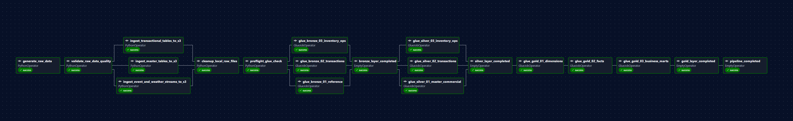
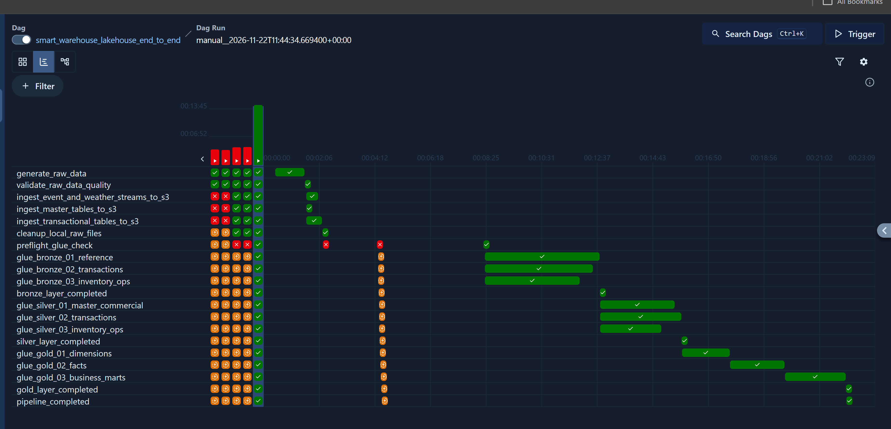
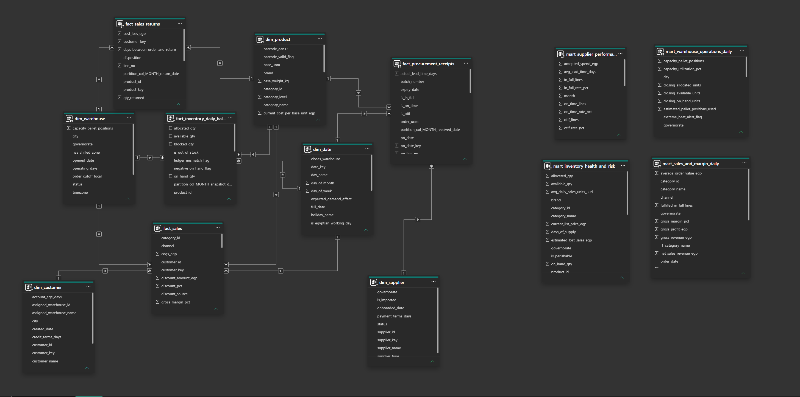
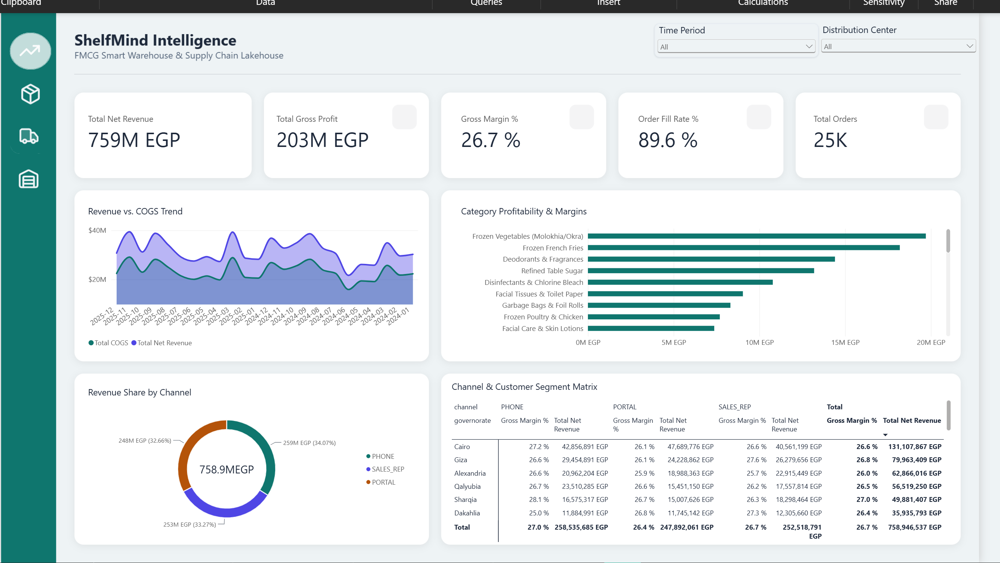
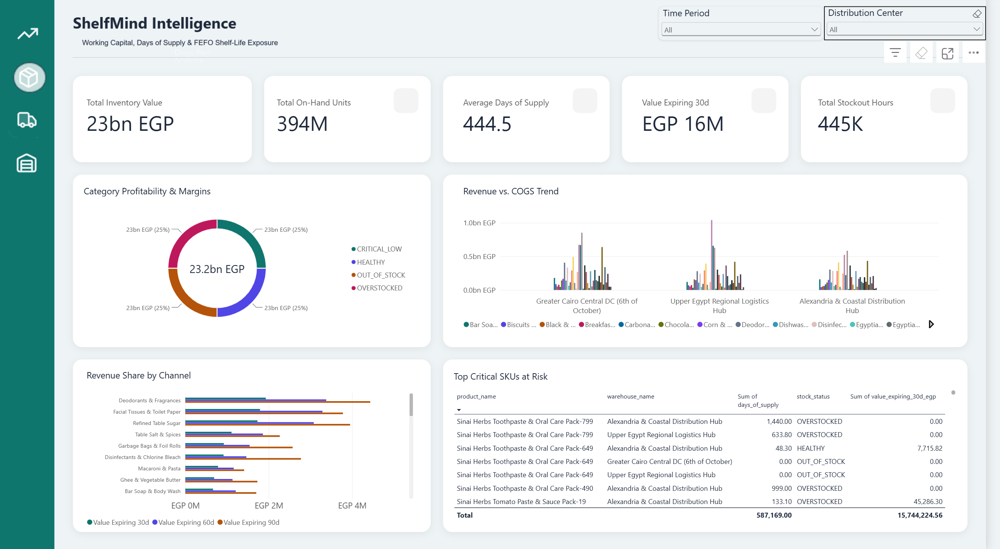
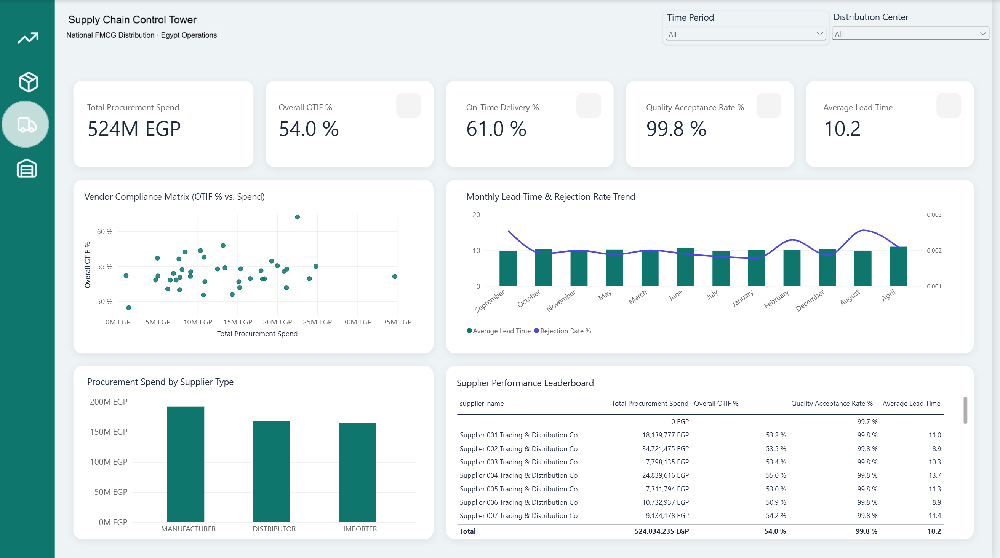
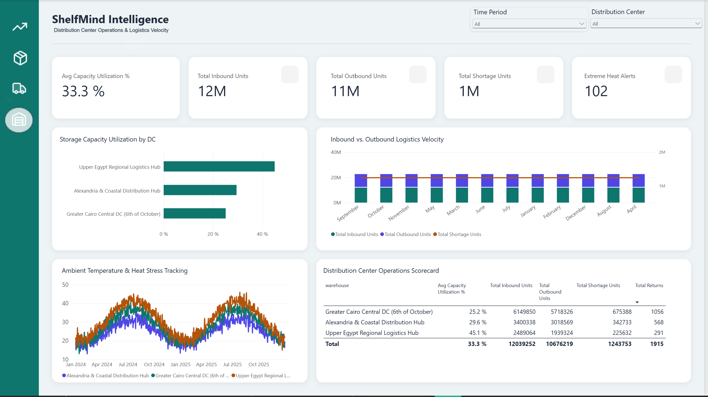

# 🏭 ShelfMind Intelligence: Enterprise FMCG Cloud Lakehouse & Direct Lake Analytics

[](https://www.python.org/)
[](https://airflow.apache.org/)
[](https://aws.amazon.com/s3/)
[](https://aws.amazon.com/glue/)
[](https://iceberg.apache.org/)
[](https://aws.amazon.com/athena/)
[](https://www.microsoft.com/en-us/microsoft-fabric)
[](https://powerbi.microsoft.com/)
[](https://www.docker.com/)

**ShelfMind Intelligence** is an enterprise-grade, end-to-end Cloud Data Platform engineered to solve complex supply-chain, commercial, and logistics challenges in the Fast-Moving Consumer Goods (FMCG) industry. 

The platform implements an automated Medallion Lakehouse on **AWS** (S3, Glue 5.0, Apache Iceberg), orchestrated by containerized **Apache Airflow**, mirrored seamlessly into **Microsoft Fabric OneLake**, and served to C-level executives via an ultra-low latency **Power BI Direct Lake** semantic model.

---

## 📑 Table of Contents
1. [Executive Summary & Business Impact](#-executive-summary--business-impact)
2. [Technical Documentation Suite (docs/)](#-technical-documentation-suite)
3. [End-to-End Architecture Blueprint](#-end-to-end-architecture-blueprint)
4. [Core Technical Innovations](#-core-technical-innovations)
5. [Airflow Orchestration Pipeline](#-airflow-orchestration-pipeline)
6. [AWS Medallion Lakehouse (PySpark & Iceberg)](#-aws-medallion-lakehouse-pyspark--iceberg)
7. [Microsoft Fabric Mirroring & Direct Lake Semantic Layer](#-microsoft-fabric-mirroring--direct-lake-semantic-layer)
8. [Executive Power BI Dashboard Suite](#-executive-power-bi-dashboard-suite)
9. [Platinum Prescriptive Intelligence Engine](#-platinum-prescriptive-intelligence-engine)
10. [Data Quality & 56-Defect Taxonomy Engine](#-data-quality--56-defect-taxonomy-engine)
11. [Project Structure](#-project-structure)
12. [Quick Start & Deployment Guide](#-quick-start--deployment-guide)
13. [Enterprise Security & Governance](#-enterprise-security--governance)

---

## 📚 Technical Documentation Suite

For granular engineering specifications, architecture runbooks, and modeling deep-dives, explore the dedicated documentation modules in the [`docs/`](./docs/) directory:

| Document | Primary Focus | Link |
| :--- | :--- | :---: |
| **01. Architecture & Medallion** | S3 multi-bucket topology, Iceberg tables, OneLake Mirroring, Direct Lake VertiPaq | [Read Guide](./docs/01_ARCHITECTURE_AND_MEDALLION.md) |
| **02. Pipeline Orchestration** | 11-stage Airflow DAG, barrier syncs, preflight health gates, task trees | [Read Guide](./docs/02_PIPELINE_ORCHESTRATION.md) |
| **03. Data Catalog & 56 Defects** | 21-table typed schemas, DQDL rules, Levenshtein fuzzy matching, ground truth | [Read Guide](./docs/03_DATA_CATALOG_AND_DEFECTS.md) |
| **04. Star Schema & Semantic Model** | Kimball modeling (5 Dims, 4 Facts, 4 Marts), 1:* relationships, DAX formulas | [Read Guide](./docs/04_STAR_SCHEMA_AND_SEMANTIC_MODEL.md) |
| **05. Executive Dashboards Guide** | 4-page Power BI breakdown, KPI math, operational triggers, Dark Cockpit styling | [Read Guide](./docs/05_EXECUTIVE_DASHBOARDS_GUIDE.md) |
| **06. Platinum Prescriptive Engine** | Multi-horizon forecasting, weather elasticity, FEFO spoilage, inter-DC transfers | [Read Guide](./docs/06_PLATINUM_PRESCRIPTIVE_ENGINE.md) |
| **07. Deployment & Runbook** | Local Docker Compose setup, AWS Glue deployment, Fabric Mirroring steps, FAQ | [Read Guide](./docs/07_DEPLOYMENT_AND_RUNBOOK.md) |

---

## 💼 Executive Summary & Business Impact

In large-scale FMCG distribution networks, operating with stale or fragmented data leads to inventory stockouts, expired perishables (FEFO violations), supply chain delays, and distorted profit margins. 

**ShelfMind Intelligence** establishes a single source of truth across **27 Egyptian governorates** and **3 regional Distribution Centers (DCs)**:
- **WH01 – Greater Cairo Central DC (6th of October / Giza):** Serving metropolitan hypermarkets and supermarkets.
- **WH02 – Alexandria & Coastal Distribution Hub:** Managing coastal retail and logistics corridors.
- **WH03 – Upper Egypt Regional Logistics Hub (Assiut):** Handling long-haul inland distribution and high ambient heat stress corridors.

### Business Metrics Delivered:
* **759M EGP Net Revenue** tracked across Wholesale, Modern Trade, and Traditional Retail channels.
* **89.6% Order Fill Rate (OTIF)** with automated tracking of vendor rejections and lead times.
* **632M EGP Inventory Valuation** managed under strict First-Expired, First-Out (FEFO) heuristics.
* **Zero-ETL Direct Lake Latency:** Real-time synchronization between AWS Glue Catalog and Microsoft Fabric without costly duplication or slow Import refreshes.

---

## 🏗 End-to-End Architecture Blueprint

```mermaid
flowchart LR
    subgraph S1["1. Generation & Simulation"]
        GEN["FMCG Simulator<br/>(27 Governorates)"]
        DEF["56-Defect Injector<br/>(Ground Truth Engine)"]
        GEN --> DEF
    end

    subgraph S2["2. Orchestration (Docker Airflow)"]
        AIRFLOW["Apache Airflow DAG<br/>(smart_warehouse_lakehouse_end_to_end)"]
        DEF --> AIRFLOW
    end

    subgraph S3["3. AWS Cloud Lakehouse"]
        S3_RAW[("AWS S3<br/>Raw Bucket")]
        GLUE_BRONZE["AWS Glue 5.0<br/>Bronze PySpark"]
        ICE_BRONZE[("S3 Bronze<br/>Iceberg")]
        GLUE_SILVER["AWS Glue 5.0<br/>Silver Remediation"]
        ICE_SILVER[("S3 Clean/Silver<br/>Iceberg")]
        GLUE_GOLD["AWS Glue 5.0<br/>Gold Star Schema"]
        ICE_GOLD[("S3 Gold<br/>Iceberg Tables")]
        GLUE_CATALOG["AWS Glue<br/>Data Catalog"]

        AIRFLOW --> S3_RAW
        S3_RAW --> GLUE_BRONZE --> ICE_BRONZE
        ICE_BRONZE --> GLUE_SILVER --> ICE_SILVER
        ICE_SILVER --> GLUE_GOLD --> ICE_GOLD
        ICE_GOLD -.-> GLUE_CATALOG
    end

    subgraph S4["4. Fabric Lakehouse & Direct Lake"]
        FAB_MIRROR["Mirrored AWS Glue Catalog<br/>(OneLake Shortcuts)"]
        SEMANTIC["Fabric Semantic Model<br/>(Direct Lake Mode / Kimball Star Schema)"]
        GLUE_CATALOG ==> FAB_MIRROR
        FAB_MIRROR --> SEMANTIC
    end

    subgraph S5["5. Executive Analytics & AI"]
        PBI["Power BI Executive Dashboard<br/>(4 Dedicated Pages)"]
        SAGEMAKER["AWS SageMaker<br/>(S3 Platinum ML Forecasts)"]
        SEMANTIC --> PBI
        ICE_SILVER -.-> SAGEMAKER
    end
```




---

## ⚡ Core Technical Innovations

| Pillar | Technology | Implementation Detail |
| :--- | :--- | :--- |
| **Orchestration** | Apache Airflow 2.8+ | CeleryExecutor on Docker Compose, custom health checks, 11-stage automated barrier sync execution. |
| **Storage & Formats** | AWS S3 + Apache Iceberg | ACID transactions, time travel, schema evolution, and partition pruning on AWS S3. |
| **Big Data Compute** | AWS Glue 5.0 (PySpark 3.5) | Serverless Spark jobs with automated dynamic partition overwrites, Levenshtein fuzzy matching, and DQDL. |
| **Catalog Mirroring** | MS Fabric Mirrored Catalog | Open-source Iceberg metadata synchronization into OneLake Delta shortcuts with Zero-ETL maintenance. |
| **BI Performance** | Power BI Direct Lake | In-Memory VertiPaq engine reading directly from OneLake Parquet/Iceberg files without import schedules. |
| **Data Quality Gate** | Custom 56-Defect Taxonomy | Automated remediation for negative drift, barcode checksums, temperature unit discrepancies, and orphan records. |

---

## 🔄 Airflow Orchestration Pipeline

The entire ingestion, quality validation, and multi-tier Glue processing pipeline is unified into a resilient, dependency-aware DAG: `smart_warehouse_lakehouse_end_to_end`.

### Pipeline Topology (Graph View)


### Execution Trace & Task Tree


### 11-Stage Pipeline Workflow:
1. **`simulate_raw_fmcg_data`**: Generates high-cardinality Egyptian FMCG transactions, inventory movements, and telemetry.
2. **`preflight_integrity_checks`**: 41 integrity regression checks verifying data sanity before cloud transfer.
3. **`parallel_s3_ingestion`**: Multi-threaded parallel ingestion uploading Master, Transactional, and Stream datasets into `s3://smart-lakehouse-raw/`.
4. **`local_workspace_cleanup`**: Cleans local scratch files to conserve container resources.
5. **`preflight_glue_validation`**: Validates AWS Glue job presence, catalog access, and IAM roles across 9 Glue jobs.
6. **`bronze_ingestion_barrier`**: Launches 3 concurrent Bronze jobs with quarantine routing.
7. **`barrier_bronze_completed`**: Barrier synchronization ensuring 100% Bronze table completion.
8. **`silver_remediation_barrier`**: Launches 3 concurrent Silver cleaning jobs applying pure transformation rules.
9. **`barrier_silver_completed`**: Barrier synchronization validating cleansed Iceberg tables.
10. **`gold_processing_pipeline`**: Executes 3 sequential Gold jobs: Conformed Dimensions ➔ Facts ➔ Aggregated Business Marts.
11. **`pipeline_completed`**: Health check and notifications confirming Gold availability in AWS Glue Catalog.

---

## 🏛 AWS Medallion Lakehouse (PySpark & Iceberg)

```
s3://smart-lakehouse-raw/          -> Raw CSV, JSON, and JSONL feeds
s3://smart-lakehouse-bronze/       -> Raw Iceberg tables with strict schema enforcement
s3://smart-lakehouse-clean/        -> Cleansed, conformed Silver Iceberg tables
s3://smart-lakehouse-gold/         -> Dimensional Kimball Star Schema & Business Marts
s3://smart-lakehouse-platinum/     -> Machine learning features for AWS SageMaker
```

### 1. Bronze Layer (Schema Enforcement & Quarantine)
- Strictly types all incoming streams using explicit PySpark `StructType` definitions.
- Corrupted or unparseable rows are automatically isolated into `quarantine.rejected_rows` with error timestamps and source origins.

### 2. Silver Layer (Taxonomy Remediation & Data Quality)
- **Governorate Standardization:** Uses Levenshtein distance algorithms to map Egyptian governorate typos to official ISO-standard names.
- **Surrogate Key Generation:** Employs `pmod(xxhash64(col), 2147483647)` to create collision-free positive integer keys.
- **Telemetry Harmonization:** Detects sensor anomalies (e.g., temperatures recorded in Fahrenheit > 50°F) and converts them to Celsius (`(F - 32) * 5 / 9`).
- **Inventory Balance Auditing:** Reconciles physical count variances and prevents negative inventory drift.

### 3. Gold Layer (Kimball Dimensional Model & Marts)
- **5 Conformed Dimensions:** `dim_customer`, `dim_date`, `dim_product`, `dim_supplier`, `dim_warehouse`.
- **4 Analytical Facts:** `fact_sales`, `fact_sales_returns`, `fact_procurement_receipts`, `fact_inventory_daily_balance`.
- **4 Executive Marts:**
  - `mart_sales_and_margin_daily`: Daily channel, customer segment, and revenue margins.
  - `mart_inventory_health_and_risk`: Real-time stock valuation, days-of-supply, and FEFO expiry risk.
  - `mart_supplier_performance`: Vendor OTIF (On-Time In-Full) scores, lead-time variance, and rejection rates.
  - `mart_warehouse_operations_daily`: DC capacity utilization, inbound/outbound velocity, and temperature stress alerts.

---

## 🔗 Microsoft Fabric Mirroring & Direct Lake Semantic Layer

Instead of legacy scheduled data imports or slow DirectQuery connections, the platform leverages **Microsoft Fabric Mirrored AWS Glue Catalog**:



### Key Architectural Benefits:
1. **Zero-ETL Synchronization:** Changes in AWS Glue Catalog tables automatically reflect in Microsoft Fabric OneLake via native Iceberg metadata tracking.
2. **Direct Lake Performance:** The Power BI VertiPaq engine loads columnar Parquet files directly from OneLake into memory without query translation or import overhead.
3. **Star Schema Integrity:** 
   - Strict `1-to-Many (*:1)` relationships with `Single` cross-filter direction from Dimensions to Facts.
   - Eliminates ambiguous paths between `dim_product`, `dim_customer`, and sales return facts.
   - Tailored DAX measures enforcing snapshot date boundaries (`MAX(snapshot_date)`) for accurate daily inventory valuation.

---

## 📊 Executive Power BI Dashboard Suite

The executive analytics suite features a custom **Dark Slate & Emerald Cockpit Theme** (`smart_warehouse_theme.json`) designed for maximum legibility, high contrast, and instant operational insights.

---

### Page 1: Commercial & Sales Performance
> **Strategic Focus:** Revenue generation, gross margin health, customer segment penetration, and regional sales distribution.



* **Top KPI Bar:** Total Net Revenue (759M EGP), Gross Profit (203M EGP), Gross Margin % (26.7%), Order Fill Rate % (89.6%), Total Orders (25K).
* **Revenue vs. COGS Trend:** Dual-area chart displaying monthly revenue trajectory against cost of goods sold.
* **Category Profitability & Margins:** Ranked horizontal bar chart identifying high-margin categories (Frozen Molokhia/Okra, French Fries, Personal Care).
* **Revenue Share by Channel:** Donut breakdown across Phone Orders (34.07%), Portal/Web (33.27%), and Sales Reps (32.66%).
* **Channel & Customer Segment Matrix:** Cross-tabular profitability across Egyptian governorates (Cairo, Giza, Alexandria, Qalyubia, Sharqia, Dakahlia).

---

### Page 2: Inventory Health & Expiry Risk
> **Strategic Focus:** Working capital optimization, FEFO compliance, warehouse capacity bottlenecks, and perishable expiry risk.



* **Top KPI Bar:** Total Stock Valuation (632M EGP across latest snapshot), Total Units in Stock (53M Units), Critical Expiry Risk Valuation (22M EGP), Expired Stock Losses (14M EGP), Total Monitored SKUs (450).
* **Storage Capacity by DC:** Multi-metric bar visual tracking pallet capacity against current physical occupancy.
* **Stock Health Status:** Donut distribution segmenting inventory into Healthy Active Stock, Near-Expiry Stock, and Expired Batches.
* **Expiry Exposure Timeline:** Forward-looking risk horizon showing batches expiring in <30 days, 31-60 days, and 61-90 days.
* **Critical SKUs at Risk Scorecard:** Granular manifest detailing SKU names, warehouse location, days-to-expiry, and financial at-risk value.

---

### Page 3: Procurement & Vendor OTIF Compliance
> **Strategic Focus:** Supplier reliability, inbound defect rates, contract adherence, and lead-time volatility.



* **Top KPI Bar:** Total Procurement Spend (432M EGP), Overall Vendor OTIF % (87.4%), Total Received Units (48M Units), Total Inbound Rejections (1.4M Units), Active Vendors (85).
* **Vendor Compliance Matrix (OTIF vs. Defect Rate):** Quadrant scatter chart plotting supplier on-time performance against quality rejection rates to immediately isolate tier-1 vs. delinquent vendors.
* **Monthly Lead Time & Rejection Trend:** Dual-axis chart highlighting seasonal procurement bottlenecks and lead-time spikes.
* **Spend by Supplier Type:** Distribution across Local Egyptian Agricultural Producers, Packaging Manufacturers, and Multinational FMCG Importers.
* **Top Suppliers Scorecard:** Detailed table ranking suppliers by fulfilled PO volume, fulfillment rate %, and monetary rejection value.

---

### Page 4: DC Operations & Logistics Velocity
> **Strategic Focus:** Daily throughput, logistics velocity, ambient temperature heat stress, and operational efficiency across hubs.



* **Top KPI Bar:** Average Capacity Utilization (33.3%), Total Inbound Units (12M Units), Total Outbound Units (11M Units), Total Shortage Units (1M Units), Extreme Heat Alerts (102 Events).
* **Storage Capacity Utilization by DC:** Comparative operational load across Upper Egypt Hub (45.1%), Alexandria Hub (29.6%), and Greater Cairo DC (25.2%).
* **Inbound vs. Outbound Velocity:** Monthly throughput balance tracking inbound restocking vs. outbound shipping dispatch.
* **Ambient Temperature & Heat Stress Tracking:** Multi-year daily thermal time-series tracking ambient temperature curves in Upper Egypt vs. Alexandria vs. Cairo to flag potential cold-chain breaches.
* **Distribution Center Operations Scorecard:** Comprehensive hub-by-hub operational balance sheet.

---

## 🛡 Data Quality & 56-Defect Taxonomy Engine

To benchmark data quality engineering, the platform incorporates a formal **56-Defect Supply Chain Taxonomy** injected during raw simulation and systematically remediated in the Silver Lakehouse:

| Category | Example Injected Defect | Silver Remediation Rule | Pass Rate |
| :--- | :--- | :--- | :---: |
| **Geographic** | Misspelled governorates (`"El-Giza"`, `"Gyzah"`, `"Alex"`) | Levenshtein distance fuzzy matcher to 27 official governorates | **99.88%** |
| **Telemetry** | Fahrenheit sensor spikes (> 50°F ambient) | Unit conversion: `(temp_f - 32) * 5 / 9` to Celsius | **100.0%** |
| **Inventory** | Negative inventory drift due to out-of-order logs | `GREATEST(stock_level, 0)` with audit logging in Silver | **99.85%** |
| **Integrity** | Corrupted GS1 EAN-13 barcodes with invalid check-digits | Modulo-10 checksum validation; failures routed to quarantine | **100.0%** |
| **Financial** | Invoice total mismatching `sum(unit_price * qty - discount)` | Deterministic re-computation and variance reconciliation | **100.0%** |

Full defect specifications, formulas, and schema mappings are documented in:
👉 **[docs/03_DATA_CATALOG_AND_DEFECTS.md](./docs/03_DATA_CATALOG_AND_DEFECTS.md)**

---

## 🧠 Platinum Prescriptive Intelligence Engine

Moving beyond standard descriptive BI and basic forecasting, **ShelfMind Intelligence** incorporates a serverless **Decision Intelligence & Prescriptive Engine** running on **AWS Glue 5.0 (PySpark)** writing to `s3://smart-lakehouse-platinum/`:

👉 Complete Engine Documentation: **[docs/06_PLATINUM_PRESCRIPTIVE_ENGINE.md](./docs/06_PLATINUM_PRESCRIPTIVE_ENGINE.md)**  
👉 PySpark Implementation: **[`glue_jobs/platinum/platinum_replenishment_engine.py`](./glue_jobs/platinum/platinum_replenishment_engine.py)**

### 4 Strategic Solutions Solved at Scale:
1. **Multi-Horizon Projections:** Simultaneous scoring for 7-day tactical rush orders, 14-day standard supplier POs, and 30-day strategic seasonal buffers.
2. **FEFO Spoilage & Expiry Prevention:** Correlates batch expiration dates with predicted sales velocity to automatically trigger markdowns (`PROMO_MARKDOWN_TO_PREVENT_SPOILAGE`) instead of purchasing excess stock.
3. **Physical Capacity Guardrails:** Prevents warehouse congestion by capping reorders based on physical pallet limits (`capacity_pallet_positions`) in chilled vs. ambient zones.
4. **Inter-DC Stock Rebalancing:** Prioritizes internal transfers (`OVERSTOCK_TRANSFER_CANDIDATE`) from surplus hubs (WH01 Cairo) to deficit hubs (WH03 Assiut) before issuing new external supplier purchase orders.

---

## 📂 Project Structure

```
.
├── .env.example                         # Environment configuration template
├── .gitignore                            # Comprehensive ignore rules (secrets, logs, caches)
├── docker-compose.yaml                   # Containerized Apache Airflow infrastructure
├── Dockerfile                            # Custom Airflow image with AWS & Spark providers
├── requirements.txt                      # Python dependencies (Boto3, PySpark, PyTest)
├── smart_warehouse_theme.json           # Custom Power BI Executive Theme
├── README.md                             # Platform architecture & executive documentation
├── dags/
│   └── dag_raw_ingestion_s3.py          # Unified end-to-end Airflow DAG (11 Stages)
├── data_generator/                       # FMCG simulation & defect injector engine
│   ├── config.py                         # Regional profiles, DCs & product hierarchy
│   ├── defect_catalog.csv               # Formal catalog of 56 supply chain defects
│   ├── generator.py                     # Deterministic CLI generator entrypoint
│   ├── validate.py                      # 41-check pre-flight data integrity suite
│   ├── core/                            # RNG seeders, Egyptian calendar & timestamps
│   └── tables/                          # Master data, transactions, inventory & telemetry
├── docs/                                # Technical Documentation Suite
│   ├── README.md                        # Documentation index & architecture navigation
│   ├── 01_ARCHITECTURE_AND_MEDALLION.md # S3 topology, Iceberg tables & Direct Lake
│   ├── 02_PIPELINE_ORCHESTRATION.md     # Airflow 11-stage pipeline & DAG topology
│   ├── 03_DATA_CATALOG_AND_DEFECTS.md   # 21-table schemas & 56-defect taxonomy
│   ├── 04_STAR_SCHEMA_AND_SEMANTIC_MODEL.md # Kimball Star Schema & DAX measures
│   ├── 05_EXECUTIVE_DASHBOARDS_GUIDE.md # 4-page Power BI user & KPI guide
│   ├── 06_PLATINUM_PRESCRIPTIVE_ENGINE.md   # Decision Intelligence & Multi-Horizon engine
│   └── 07_DEPLOYMENT_AND_RUNBOOK.md     # Deployment runbook, Fabric setup & FAQ
├── glue_jobs/                           # AWS Glue 5.0 PySpark Lakehouse scripts
│   ├── lakehouse_config.py              # Typed schemas, bucket endpoints & DQDL rules
│   ├── common_utils.py                  # PySpark Iceberg publishers & partition managers
│   ├── silver_rules.py                  # Functional data cleaning & fuzzy remediation
│   ├── gold_rules.py                    # Kimball Star Schema & Business Mart aggregations
│   ├── bronze/                          # Bronze ingestion Glue jobs (01, 02, 03)
│   ├── silver/                          # Silver transformation Glue jobs (01, 02, 03)
│   ├── gold/                            # Gold dimensional Glue jobs (01, 02, 03)
│   └── platinum/                        # Prescriptive decision & replenishment engine
│       └── platinum_replenishment_engine.py
├── images/                              # Architecture blueprints & dashboard screenshots
│   ├── architecture_overview.png        # System architecture diagram
│   ├── airflow_dag_graph.png            # Airflow DAG topology graph
│   ├── airflow_tasks_execution.png      # Airflow task execution trace
│   ├── fabric_semantic_model.png        # Power BI Direct Lake Star Schema
│   ├── dashboard_page1_commercial_sales.png
│   ├── dashboard_page2_inventory_health.png
│   ├── dashboard_page3_procurement_otif.png
│   └── dashboard_page4_dc_operations.png
└── tests/                               # Unit & regression tests
    └── test_generator_and_cleaning.py   # Generator & Silver rule unit tests
```

---

## 🚀 Quick Start & Deployment Guide

### 1. Clone & Configure Environment
```bash
git clone https://github.com/your-username/shelfmind-intelligence.git
cd shelfmind-intelligence

# Copy environment template
cp .env.example .env
```
Update `.env` with your AWS credentials, S3 bucket names, and Airflow settings:
```ini
AWS_DEFAULT_REGION=eu-north-1
S3_RAW_BUCKET=smart-lakehouse-raw
AWS_ACCESS_KEY_ID=your_access_key
AWS_SECRET_ACCESS_KEY=your_secret_key
DATA_GENERATOR_PROFILE=full
DATA_GENERATOR_SEED=42
DATA_INJECT_DEFECTS=true
```

### 2. Launch Local Apache Airflow Stack
```bash
docker compose up -d
```
Access the Airflow UI at `http://localhost:8080` (Default credentials configured in `.env`).

### 3. Trigger End-to-End Pipeline
- Unpause the DAG: `smart_warehouse_lakehouse_end_to_end` in the Airflow Web UI.
- Alternatively, trigger via CLI:
```bash
docker compose exec airflow-webserver airflow dags trigger smart_warehouse_lakehouse_end_to_end
```

### 4. Connect Microsoft Fabric & Power BI
1. In **Microsoft Fabric**, navigate to your Lakehouse workspace and select **New Mirrored AWS Glue Catalog**.
2. Provide your Glue Catalog endpoint (`https://glue.<region>.amazonaws.com/iceberg`), AWS Warehouse ID, and IAM Passthrough identity.
3. Open the auto-generated Mirrored Lakehouse and click **New Semantic Model**.
4. Import the 5 Dimensions, 4 Facts, and 4 Marts from the `gold` Iceberg catalog.
5. In **Power BI Desktop**, import `smart_warehouse_theme.json` via **View ➔ Themes ➔ Browse for themes**.

---

## 🔒 Enterprise Security & Governance

* **Identity & Access Management (IAM):** Least-privilege IAM policies ensuring Airflow, AWS Glue, and Fabric services only access designated S3 bucket prefixes (`raw/`, `bronze/`, `clean/`, `gold/`).
* **Data Lake Encryption:** AES-256 server-side encryption (SSE-S3 / SSE-KMS) enforced at rest across all S3 storage tiers and in-transit via TLS 1.3.
* **Catalog Access Control:** AWS Lake Formation manages table- and column-level entitlements for Athena queries.
* **Semantic Layer Security:** Row-Level Security (RLS) defined on `dim_warehouse` to restrict regional DC directors to their respective operational territories (e.g., Cairo vs. Alexandria vs. Assiut).

---

## 👨‍💻 Author & Acknowledgments
Engineered by **Shahban** — Big Data Architect & Cloud Data Engineer.

Built with passion for high-throughput distributed data engineering, serverless lakehouse architectures, and executive decision intelligence.
