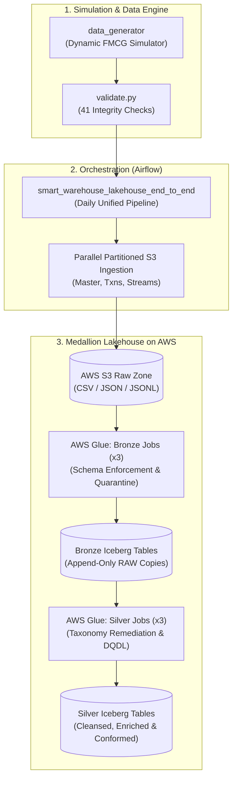

# 🏭 Smart Warehouse Intelligence Platform on AWS

[](https://www.python.org/downloads/)
[](https://airflow.apache.org/)
[](https://iceberg.apache.org/)
[](https://aws.amazon.com/glue/)
[](https://aws.amazon.com/s3/)

An enterprise-grade, end-to-end Cloud Lakehouse platform engineered on **AWS** and orchestrated with **Apache Airflow** for real-time supply chain intelligence, FMCG warehouse operations, and data quality engineering.

---

## 📌 Architecture Overview



---

## 🚀 Key Platform Features

1. **Realistic FMCG Discrete-Event Simulation (`data_generator`)**:
   - Built specifically around the **Egyptian FMCG retail/wholesale context** across all **27 governorates**.
   - Operating under 3 central distribution hubs: **WH01 (Giza / Greater Cairo)**, **WH02 (Alexandria / Coast)**, and **WH03 (Assiut / Upper Egypt)**.
   - Strict **FEFO** (First-Expired First-Out) lot picking, 14-day backorder lifecycle, non-frozen operational shift timestamps, and Friday work-stoppages.

2. **Formal 56-Defect Taxonomy & Ground Truth Engine**:
   - Injects realistic real-world data quality anomalies (Fahrenheit temperature spikes, orphan category parents, corrupted GS1 EAN-13 barcodes, duplicated order headers, negative inventory drifts, mismatched invoice totals).
   - Every defect is logged row-by-row and column-by-column in `defect_ground_truth.json` for validation and benchmarking.
   - Comprehensive documentation in [RAW_DATA_CATALOG_AND_DEFECTS.md](./RAW_DATA_CATALOG_AND_DEFECTS.md).

3. **Automated End-to-End Orchestration**:
   - Orchestrated via Airflow DAG: `smart_warehouse_lakehouse_end_to_end`.
   - Executes 8 cohesive stages: Local Data Generation ➔ Quality Pre-Flight ➔ 3-Way S3 Ingestion ➔ Local Cleanup ➔ Glue Pre-Flight ➔ 3 Concurrent Bronze Jobs ➔ Barrier Sync ➔ 3 Concurrent Silver Jobs.

4. **Production-Ready PySpark & AWS Glue Lakehouse**:
   - **Bronze Layer**: Schema enforcement, type safety, and automatic routing of corrupt lines to `quarantine.rejected_rows`.
   - **Silver Layer**: Pure transformation rules in `silver_rules.py` repairing data, generating positive surrogate keys via `pmod(xxhash64)`, fuzzy-matching Egyptian governorates (Levenshtein distance), and enforcing three-valued logic.

---

## 📂 Project Structure

```
├── dags/
│   └── dag_raw_ingestion_s3.py     # Main end-to-end Airflow DAG
├── data_generator/                 # Simulation engine & defect injector
│   ├── config.py                   # Profile settings & warehouse mapping
│   ├── defect_catalog.csv          # Catalog of all 56 formal defects
│   ├── generator.py                # Main generator entrypoint
│   ├── validate.py                 # 41 integrity regression checks
│   ├── core/                       # Deterministic RNG & Egyptian time utilities
│   └── tables/                     # Reference, Master, Commercial & Simulation tables
├── glue_jobs/                      # AWS Glue & PySpark ETL scripts
│   ├── lakehouse_config.py         # 21-table typed schemas and DQDL rules
│   ├── silver_rules.py             # Pure functional data cleaning rules
│   ├── common_utils.py             # Shared PySpark UDFs & utilities
│   ├── bronze/                     # Bronze Glue jobs (01, 02, 03)
│   └── silver/                     # Silver Glue jobs (01, 02, 03)
├── docker-compose.yaml             # Local Apache Airflow stack
├── RAW_DATA_CATALOG_AND_DEFECTS.md # Engineering catalog & schema specification
└── requirements.txt                # Python package dependencies
```

---

## ⚡ Quick Start

### 1. Environment Setup
Copy the environment template and configure your AWS credentials:
```bash
cp .env.example .env
```

### 2. Generate and Validate Synthetic Data
```bash
# Install dependencies
pip install -r requirements.txt

# Run generator with full profile
python -m data_generator.generator --profile test --seed 7 --output-dir data/raw

# Run the 41-check integrity validator
python -m data_generator.validate data/raw
```

### 3. Launch Airflow Pipeline
```bash
docker compose up -d
```
Access the Airflow UI at `http://localhost:8080`.

---

## 📖 Documentation

For detailed schema specifications, table descriptions, partitioning strategies, and the complete defect taxonomy, refer to:
👉 **[RAW_DATA_CATALOG_AND_DEFECTS.md](./RAW_DATA_CATALOG_AND_DEFECTS.md)**
