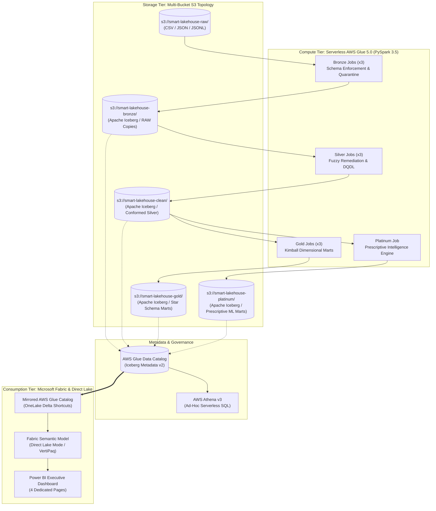

# 🏛 01. Cloud Architecture & Medallion Lakehouse

## 1. High-Level Architectural Vision

**ShelfMind Intelligence** bridges distributed big data engineering on AWS with real-time enterprise decision analytics on Microsoft Fabric.

---

## 2. The 4 Medallion Storage Zones

### 1. RAW Zone (`s3://smart-lakehouse-raw/`)
* **Format:** Raw CSV, JSON, and JSONL feeds.
* **Structure:** Ingested in 3 partitioned streams (`master/`, `transactions/`, `streams/`).
* **Retention Policy:** Immutable landing zone with automated lifecycle transition to S3 Glacier after 90 days.

### 2. BRONZE Zone (`s3://smart-lakehouse-bronze/`)
* **Format:** Apache Iceberg backed by Parquet.
* **Role:** Type-safe, append-only lakehouse replica of raw data.
* **Schema Enforcement:** Strict PySpark `StructType` definitions. Failed rows are isolated into `quarantine.rejected_rows` with original payload JSON and stacktrace reasons.

### 3. SILVER Zone (`s3://smart-lakehouse-clean/`)
* **Format:** Apache Iceberg partitioned by month of transaction date.
* **Role:** Cleansed, conformed, and standardized enterprise data.
* **Transformations Applied:**
  * **Levenshtein Fuzzy Matching:** Resolves misspelled Egyptian governorates (e.g., `"El-Giza"` ➔ `"Giza"`).
  * **Surrogate Key Generation:** Positive integer hash keys via `pmod(xxhash64(key), 2147483647)`.
  * **Thermal Sensor Harmonization:** Conversion of Fahrenheit temperature spikes (>50°F) to Celsius: `(temp_f - 32) * 5 / 9`.
  * **Negative Inventory Drift Prevention:** Cumulative ledger reconciliation to prevent negative on-hand counts.

### 4. GOLD Zone (`s3://smart-lakehouse-gold/`)
* **Format:** Apache Iceberg with hidden partitioning.
* **Role:** Kimball Star Schema dimensional models and aggregated business marts.
* **Contents:** 5 Conformed Dimensions (`dim_customer`, `dim_date`, `dim_product`, `dim_supplier`, `dim_warehouse`), 4 Facts, and 4 Marts.

### 5. PLATINUM Zone (`s3://smart-lakehouse-platinum/`)
* **Format:** Apache Iceberg.
* **Role:** Prescriptive Intelligence and Machine Learning Feature Store.
* **Contents:** Multi-horizon demand forecasts, thermal sensitivity scores, FEFO spoilage alerts, and inter-DC rebalancing recommendations.

---

## 3. Microsoft Fabric Zero-ETL Mirroring & Direct Lake Mode

Traditional lakehouse-to-BI architectures suffer from either:
1. **Scheduled Imports:** High refresh latency (hours), data duplication, and memory limits.
2. **DirectQuery:** Slow queries (several seconds/minutes), translation bottlenecks, and high database compute costs.

### How Direct Lake Solves This:
* **Zero-ETL Synchronization:** Microsoft Fabric mirrors the AWS Glue Catalog using native Apache Iceberg metadata readers. Parquet data files remain in AWS S3 and are mapped via OneLake shortcuts.
* **Sub-Second VertiPaq Queries:** The Power BI VertiPaq analytical engine loads the columnar Parquet files from OneLake directly into RAM, bypassing traditional SQL query parsers.
* **Continuous Consistency:** Any batch completed by AWS Glue is visible in Power BI within seconds without manual refresh triggers.
