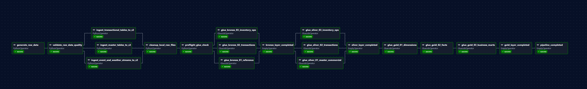
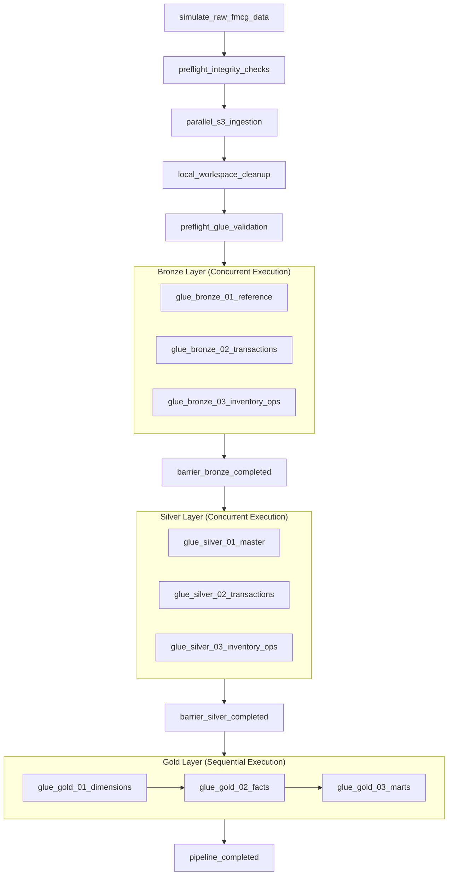
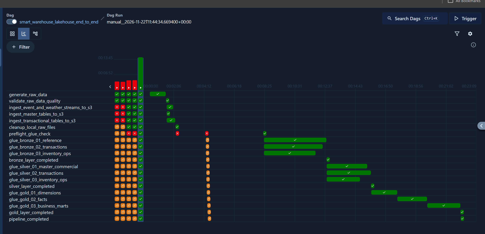

# 🔄 02. Pipeline Orchestration & Apache Airflow DAGs

## 1. Orchestration Architecture

The orchestration engine coordinates data generation, regression integrity checks, multi-bucket S3 ingestion, and parallel AWS Glue jobs using **Apache Airflow 2.8+** on Docker Compose.

```
DAG ID: smart_warehouse_lakehouse_end_to_end
Schedule: Daily @ 02:00 Africa/Cairo
Executor: CeleryExecutor (Redis + PostgreSQL)
```

---

## 2. DAG Topology & Dependency Graph





---

## 3. The 11 Cohesive Execution Stages

| Stage # | Task Name | Description & Success Criteria |
| :---: | :--- | :--- |
| **01** | `simulate_raw_fmcg_data` | Executes `data_generator.generator` to simulate high-cardinality Egyptian FMCG orders, shipments, inventory snapshots, and weather observations. |
| **02** | `preflight_integrity_checks` | Runs 41 deterministic validation checks in `validate.py` (checksums, foreign key presence, positive prices) before cloud network transfer. |
| **03** | `parallel_s3_ingestion` | Multi-threaded Python/Boto3 upload streaming files directly to `s3://smart-lakehouse-raw/`. |
| **04** | `local_workspace_cleanup` | Removes local temporary CSVs/JSONs to prevent storage exhaustion inside Docker worker containers. |
| **05** | `preflight_glue_validation` | Probes the AWS Glue API to verify that all 9 Glue jobs exist, IAM execution roles are valid, and target Iceberg catalogs are reachable. |
| **06** | `bronze_ingestion_barrier` | Triggers 3 concurrent AWS Glue Bronze jobs with schema enforcement. |
| **07** | `barrier_bronze_completed` | Barrier synchronization operator that polls job completion and blocks downstream execution if any Bronze job fails. |
| **08** | `silver_remediation_barrier` | Triggers 3 concurrent AWS Glue Silver jobs applying Levenshtein fuzzy matching and business defect remediation rules. |
| **09** | `barrier_silver_completed` | Barrier synchronization validating that all cleansed Silver Iceberg tables have updated snapshots. |
| **10** | `gold_processing_pipeline` | Sequentially builds Conformed Dimensions ➔ Core Facts ➔ Analytical Business Marts. |
| **11** | `pipeline_completed` | Emits pipeline telemetry metrics, logs completion timestamps, and signals Microsoft Fabric OneLake synchronization. |

---

## 4. Execution Trace & Task Tree View



### Failure Recovery & Idempotency:
* All AWS Glue jobs use **Iceberg Atomic Merges (`MERGE INTO`)** or **Overwrite with Partition Pruning**.
* Re-running any failed task in Airflow does not cause duplicate records or partial writes in the lakehouse.
