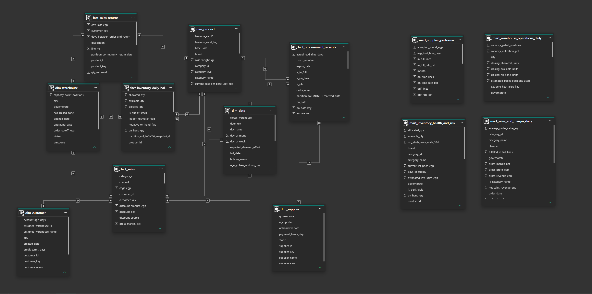

# 📐 04. Star Schema & Fabric Semantic Model

## 1. Kimball Dimensional Modeling Overview

The Gold analytical layer implements a classic **Kimball Star Schema** optimized for high-performance in-memory indexing in **Power BI Direct Lake mode**.



---

## 2. Model Structure: Dimensions, Facts, and Marts

### Conformed Dimensions (5 Tables)
1. **`dim_date`**: Grain: 1 row per calendar day. Contains Egyptian calendar markers, Islamic holidays, Gregorian attributes, fiscal periods, and Friday warehouse closures.
2. **`dim_product`**: Grain: 1 row per SKU. Contains product descriptions, brands, packaging units per case, storage type (`AMBIENT` vs. `CHILLED`), perishability flags, and shelf-life in days.
3. **`dim_warehouse`**: Grain: 1 row per distribution center (`WH01` Greater Cairo, `WH02` Alexandria, `WH03` Assiut). Contains physical pallet capacities, chilled zone presence, and operating days.
4. **`dim_customer`**: Grain: 1 row per retail/wholesale customer. Contains customer segment (`WHOLESALE`, `MODERN_TRADE`, `TRADITIONAL_RETAIL`), governorate, and credit terms.
5. **`dim_supplier`**: Grain: 1 row per vendor. Contains supplier type (Local Manufacturer vs. Importer), contractual lead times, and payment terms.

### Core Fact Tables (4 Tables)
1. **`fact_sales`**: Grain: 1 row per sales order line item. Contains ordered quantities, allocated quantities, shipped quantities, net revenue, discounts, and COGS.
2. **`fact_sales_returns`**: Grain: 1 row per return line item. Contains return reasons, refund amounts, and disposition status.
3. **`fact_procurement_receipts`**: Grain: 1 row per dock receipt line. Contains received quantities, rejected quantities, batch numbers, and supplier delivery notes.
4. **`fact_inventory_daily_balance`**: Grain: 1 row per warehouse, product, and snapshot day. Contains on-hand quantities, allocated units, and blocked stock.

### Executive Business Marts (4 Tables)
1. **`mart_sales_and_margin_daily`**: Pre-aggregated daily profitability by channel, governorate, and customer segment.
2. **`mart_inventory_health_and_risk`**: Real-time stock valuation, days-of-supply, and FEFO expiry risk buckets.
3. **`mart_supplier_performance`**: Vendor OTIF scores, lead-time variances, and quality rejection rates.
4. **`mart_warehouse_operations_daily`**: DC capacity utilization %, inbound/outbound throughput velocity, and ambient heat stress alerts.

---

## 3. Relationship Cardinality & Ambiguity Resolution

* **Cardinality:** All relationships between Dimensions and Facts are strictly **`One-to-Many (1:*)`**.
* **Cross-Filter Direction:** Configured as **`Single`** (Dimension filters Fact).
* **Elimination of Ambiguous Paths:** In multi-fact models with sales and returns, bidirectional cross-filtering introduces circular dependency errors (e.g. between `dim_product`, `fact_sales`, and `fact_sales_returns`). Setting `Single` direction ensures clean, unambiguous query trees.

---

## 4. Key DAX Measures & Formulations

### 1. Cumulative Snapshot Fix for Daily Inventory Valuation:
```dax
Total Stock Valuation (EGP) = 
CALCULATE(
    SUMX(
        fact_inventory_daily_balance,
        fact_inventory_daily_balance[on_hand_qty] * RELATED(dim_product[unit_cost_egp])
    ),
    fact_inventory_daily_balance[snapshot_date] = MAX(fact_inventory_daily_balance[snapshot_date])
)
```
> **Architecture Note:** Without filtering on `MAX(snapshot_date)`, summing across daily periodic snapshots would result in cumulative multiplication across days (e.g., displaying 23 Billion EGP instead of the true 632 Million EGP balance).

### 2. Operational Capacity Utilization Fix:
```dax
Avg Capacity Utilization % = 
AVERAGE(mart_warehouse_operations_daily[capacity_utilization_pct]) / 100
```
> **Architecture Note:** Since AWS Glue pre-multiplies percentages by 100, dividing by 100 in DAX ensures proper formatting as `33.3%` rather than `3326.8%`.

### 3. Vendor On-Time In-Full (OTIF) Rate:
```dax
Vendor OTIF % = 
DIVIDE(
    CALCULATE(COUNTROWS(fact_procurement_receipts), fact_procurement_receipts[is_otif] = TRUE()),
    COUNTROWS(fact_procurement_receipts),
    0
)
```
