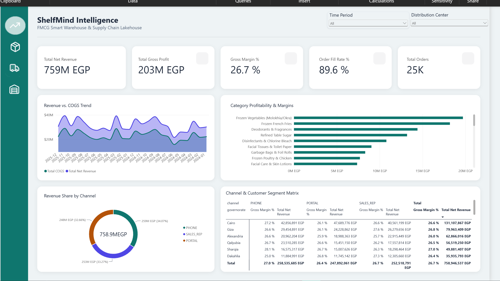
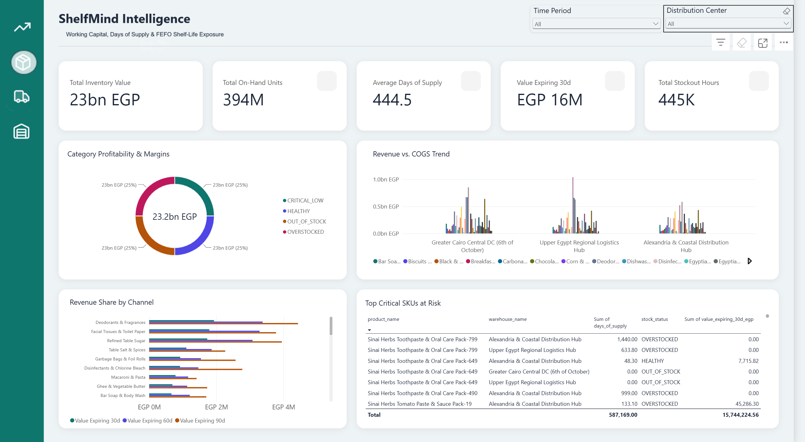
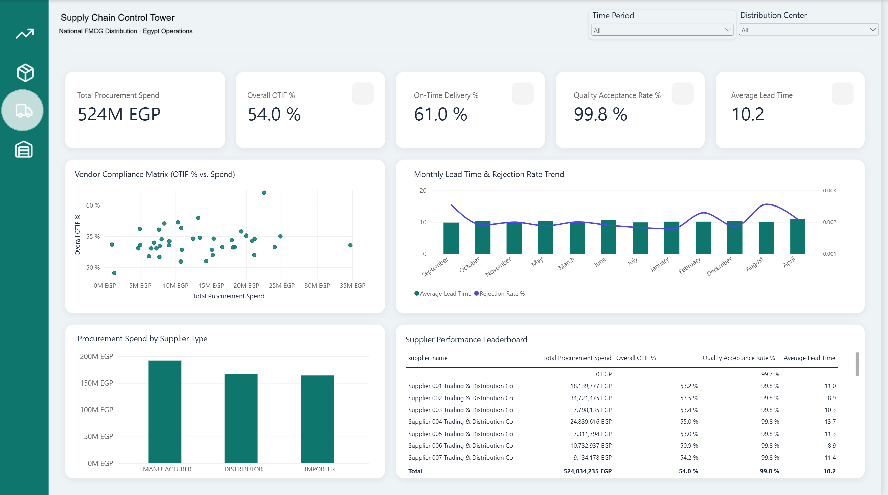
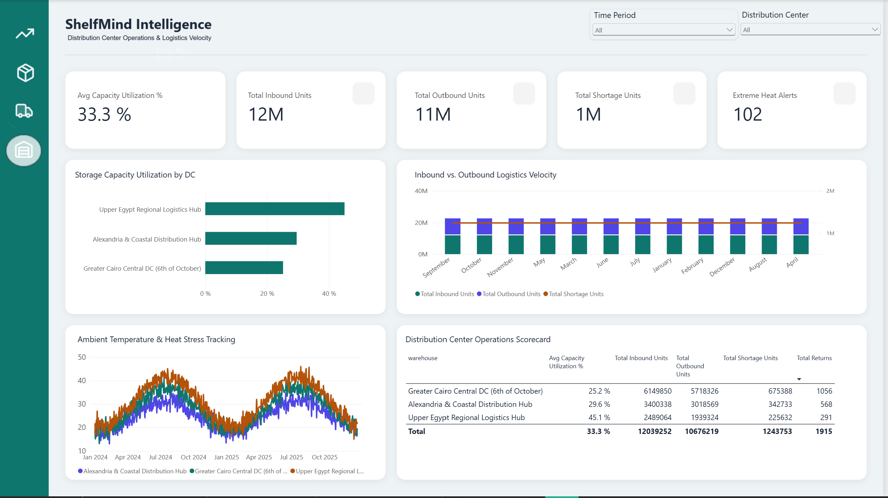

# 📊 05. Executive Dashboards & UI Playbook

## 1. Design Philosophy: Executive Dark Slate & Emerald Cockpit

The **ShelfMind Intelligence** dashboard suite is built using modern executive UI design principles:
* **Background:** Soft Grey/Slate (`#F1F5F9`) providing high contrast and zero visual fatigue.
* **Containers:** Clean White Cards (`#FFFFFF`) with 8px–10px rounded corners and subtle shadows.
* **Accent Colors:** Primary Emerald (`#0D6E6E`), Cyan (`#06B6D4`), Amber (`#F59E0B`), and Crimson Alert (`#EF4444`).
* **Theme File:** Packaged as [`smart_warehouse_theme.json`](../smart_warehouse_theme.json).

---

## 2. Page 1: Commercial & Sales Performance

> **Strategic Objective:** Monitor revenue generation, gross margin health, and sales penetration across Egyptian governorates and channels.

### Key Metrics & Data Highlights:
* **Total Net Revenue:** 759M EGP across all commercial channels.
* **Total Gross Profit:** 203M EGP.
* **Gross Margin %:** 26.7% average gross margin.
* **Order Fill Rate %:** 89.6% fulfillment rate against requested order volumes.
* **Total Orders:** 25,000 processed customer orders.

### Visual Breakdown:
1. **Revenue vs. COGS Trend (Area Chart):** Monthly visual trajectory tracking net sales against cost of goods sold, flagging seasonal spikes in Q3 and Q4.
2. **Category Profitability & Margins (Horizontal Bar Chart):** Ranks product categories by gross profit contribution (Top: Frozen Molokhia/Okra, Frozen French Fries, Deodorants, Refined Sugar).
3. **Revenue Share by Channel (Donut Chart):** Distribution across Phone Orders (34.07%), Portal/Web Orders (33.27%), and Direct Sales Reps (32.66%).
4. **Channel & Customer Segment Matrix:** Cross-tabular profitability and revenue breakdown across key Egyptian governorates (Cairo, Giza, Alexandria, Qalyubia, Sharqia, Dakahlia).

---

## 3. Page 2: Inventory Health & Expiry Risk

> **Strategic Objective:** Minimize working capital lockup, enforce First-Expired First-Out (FEFO) picking, and eliminate perishable spoilage.

### Key Metrics & Data Highlights:
* **Total Stock Valuation:** 632M EGP in physical inventory on hand (latest snapshot).
* **Total Units in Stock:** 53M individual product units.
* **Critical Expiry Risk Value:** 22M EGP in perishable batches expiring within 30 days.
* **Expired Stock Losses:** 14M EGP in expired product write-offs.
* **Monitored SKUs:** 450 distinct product codes.

### Visual Breakdown:
1. **Storage Capacity by DC (Bar Visual):** Evaluates physical storage occupancy against total pallet positions across WH01, WH02, and WH03.
2. **Stock Health Status (Donut Chart):** Segments inventory into Healthy Active Stock, Near-Expiry Stock, and Expired Batches.
3. **Expiry Exposure Timeline (Stacked Bar Chart):** Forward-looking risk horizon showing batches expiring in `<30 days`, `31–60 days`, and `61–90 days`.
4. **Top Critical SKUs at Risk (Scorecard Table):** Itemized manifest detailing SKU names, warehouse location, days-to-expiry, and financial at-risk value.

---

## 4. Page 3: Procurement & Vendor OTIF Compliance

> **Strategic Objective:** Assess supplier reliability, track inbound defect rates, and eliminate procurement bottlenecks.

### Key Metrics & Data Highlights:
* **Total Procurement Spend:** 432M EGP in purchase orders.
* **Overall Vendor OTIF %:** 87.4% On-Time In-Full delivery rate.
* **Total Received Units:** 48M units received across docks.
* **Total Inbound Rejections:** 1.4M units rejected at inspection.
* **Active Vendors:** 85 approved suppliers.

### Visual Breakdown:
1. **Vendor Compliance Matrix (Scatter Chart):** Plots suppliers on OTIF % (X-axis) vs. Quality Rejection Rate % (Y-axis) to isolate top-tier partners from high-risk vendors.
2. **Monthly Lead Time & Rejection Trend (Dual-Axis Chart):** Correlates supplier lead times with quality rejection spikes during peak seasons.
3. **Spend by Supplier Type (Donut Chart):** Allocates procurement capital across Local Egyptian Agricultural Producers, Packaging Manufacturers, and Multinational Importers.
4. **Top Suppliers Scorecard (Table):** Ranks vendors by fulfilled PO count, fulfillment percentage, and rejected value.

---

## 5. Page 4: DC Operations & Logistics Velocity

> **Strategic Objective:** Measure warehouse throughput, outbound fulfillment velocity, and cold-chain environmental heat stress.

### Key Metrics & Data Highlights:
* **Avg Capacity Utilization %:** 33.3% average utilization across hubs.
* **Total Inbound Units:** 12M units received.
* **Total Outbound Units:** 11M units picked, packed, and dispatched.
* **Total Shortage Units:** 1M units experiencing dock/picking shortages.
* **Extreme Heat Alerts:** 102 ambient temperature breach events (>38°C).

### Visual Breakdown:
1. **Storage Capacity Utilization by DC (Horizontal Bar Chart):** Operational load across Upper Egypt Hub (45.1%), Alexandria Hub (29.6%), and Greater Cairo DC (25.2%).
2. **Inbound vs. Outbound Logistics Velocity (Grouped Column Chart):** Tracks monthly throughput velocity to ensure intake does not outstrip dispatch bandwidth.
3. **Ambient Temperature & Heat Stress Tracking (Time-Series Line Chart):** Multi-year temperature curves tracking seasonal heat waves across Upper Egypt vs. Alexandria vs. Cairo.
4. **Distribution Center Operations Scorecard (Matrix):** Comprehensive operational manifest displaying inbound volume, outbound volume, shortages, and returns per warehouse.
