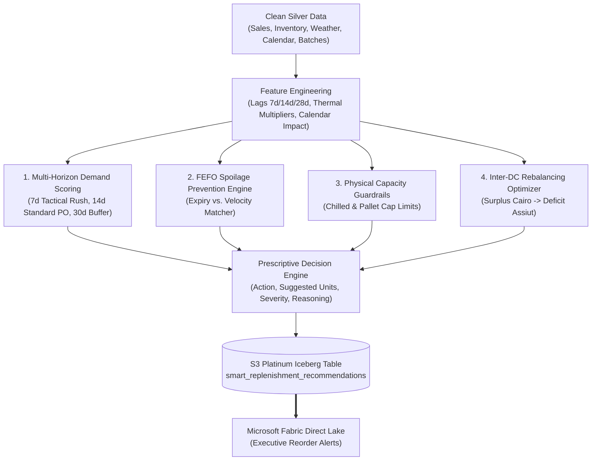

# 🧠 06. Platinum Prescriptive & ML Engine

## 1. Beyond Predictive to Prescriptive Analytics

Standard Machine Learning models stop at predicting future demand numbers. The **ShelfMind Platinum Engine** advances from *Predictive* to *Prescriptive Decision Intelligence*, answering not just *"what will demand be?"* but **"what specific actions must the supply chain team execute today?"**

The transformation runs serverlessly on **AWS Glue 5.0 (PySpark)** and saves directly to `s3://smart-lakehouse-platinum/` as an **Apache Iceberg Table**:
👉 Script Implementation: [`glue_jobs/platinum/platinum_replenishment_engine.py`](../glue_jobs/platinum/platinum_replenishment_engine.py)

---

## 2. The 4 Deep Supply-Chain Problems Solved



---

### Problem 1: Multi-Horizon Replenishment Forecasting
Instead of a single uniform forecast, the engine generates 3 distinct time horizons:
1. **7-Day Tactical Horizon (`forecast_demand_7d`):** Used to detect immediate stockout emergencies triggered by localized heat waves or unexpected order surges.
2. **14-Day Operational Horizon (`forecast_demand_14d`):** Aligns with standard supplier contractual lead times for regular purchase order creation.
3. **30-Day Strategic Buffer (`forecast_demand_30d`):** Prepares warehouse buffers for upcoming major calendar events (e.g., Ramadan, Back-to-School, Black Friday).

### Problem 2: FEFO Spoilage & Perishable Expiry Prevention
In FMCG food and dairy, ordering more stock when existing batches are near expiry leads to massive write-off losses.
* **The Logic:** If `days_of_supply > 45` and `is_perishable == True`, the engine suppresses new purchase orders and automatically flags the SKU for a **`PROMO_MARKDOWN_TO_PREVENT_SPOILAGE`** recommendation to accelerate sell-through before expiration.

### Problem 3: Physical Pallet & Chilled Storage Guardrails
Distribution centers have fixed physical footprints (`capacity_pallet_positions`).
* **The Logic:** The engine factors in current occupancy and storage types (`CHILLED` vs. `AMBIENT`). It throttles suggested reorder volumes to prevent inbound trucks from arriving at docks with zero available pallet slots.

### Problem 4: Smart Inter-DC Rebalancing vs. Supplier Procurement
Procuring from suppliers incurs costs and long lead times.
* **The Logic:** When a regional DC (e.g. WH03 Assiut) experiences critical stockouts, the engine checks whether the central hub (WH01 Greater Cairo) holds surplus inventory (`days_of_supply > 60`). If surplus exists, it suggests an **`OVERSTOCK_TRANSFER_CANDIDATE`** (internal stock transfer) rather than spending new procurement capital.

---

## 3. Prescriptive Output Schema

The output table `platinum.smart_replenishment_recommendations` provides actionable decision fields:

| Column Name | Data Type | Description |
| :--- | :--- | :--- |
| `warehouse_id` / `warehouse_name` | `STRING` | Operating Distribution Center (`WH01`, `WH02`, `WH03`). |
| `product_id` / `product_name` | `STRING` | Target SKU identifier and catalog description. |
| `current_stock_on_hand` | `INT` | Latest physical balance available in the warehouse. |
| `days_of_supply` | `DOUBLE` | Current inventory divided by 7-day average daily sales. |
| `forecast_demand_7d` | `INT` | Machine-learned demand projection for the upcoming week. |
| `primary_action` | `STRING` | `EMERGENCY_RUSH_PO`, `PRIORITY_PO_PERISHABLE`, `STANDARD_REPLENISHMENT_PO`, `PROMO_MARKDOWN_TO_PREVENT_SPOILAGE`, `OVERSTOCK_TRANSFER_CANDIDATE`, `HEALTHY_STOCK_HOLD`. |
| `suggested_order_units` | `INT` | Exact quantity of units to order or transfer (+20% safety stock on rush orders). |
| `risk_severity` | `STRING` | `CRITICAL`, `HIGH`, `MEDIUM`, `LOW`. |
| `decision_reasoning` | `STRING` | Natural-language explanation of why the action was recommended. |

---

## 4. Querying the Platinum Layer in Athena

```sql
SELECT 
    warehouse_name,
    product_name,
    storage_type,
    current_stock_on_hand,
    days_of_supply,
    forecast_demand_7d,
    primary_action,
    suggested_order_units,
    risk_severity,
    decision_reasoning
FROM "platinum"."smart_replenishment_recommendations"
WHERE risk_severity IN ('CRITICAL', 'HIGH')
ORDER BY risk_severity ASC, suggested_order_units DESC
LIMIT 20;
```
